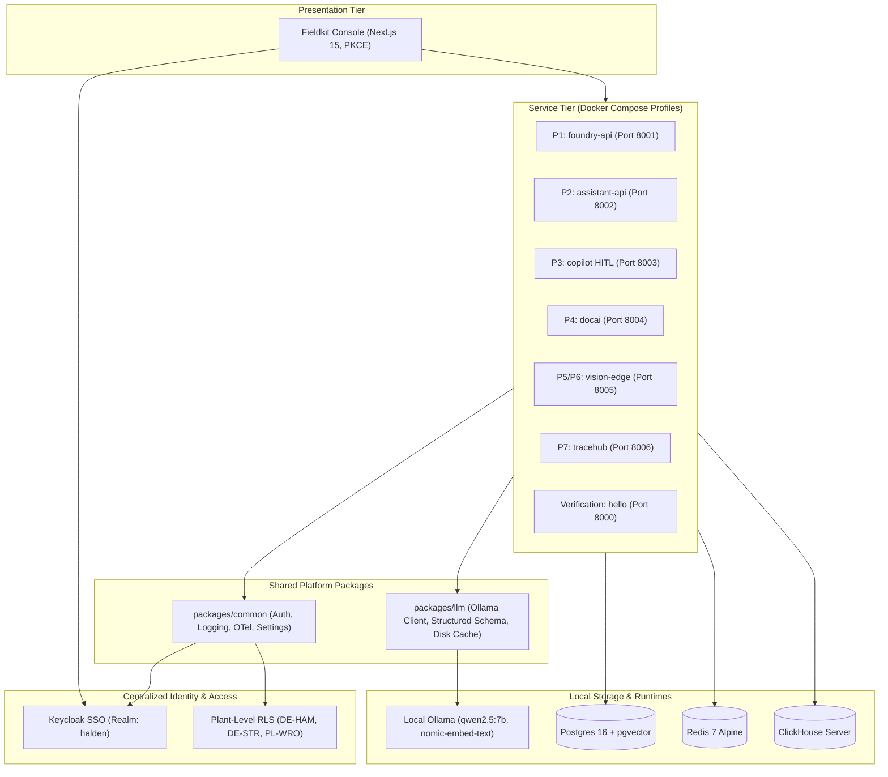

# Fieldkit

> **Forward-Deployed AI & Data Platform for Industrial Manufacturing**

Fieldkit is a production-grade, local-first enterprise AI platform built for forward-deployed engineering engagements. Designed around a realistic customer engagement (**Halden Industrie GmbH**, a German hydraulic components manufacturer), Fieldkit unifies data fusion, hybrid RAG, multi-agent operations, document intelligence, edge computer vision, and air-gapped deployment into a single coherent system.

---

## Architecture Overview



---

## Architectural Trade-Offs

| Decision | Alternative Considered | Trade-Off & Rationale | ADR |
| :--- | :--- | :--- | :--- |
| **Local Ollama Only ($0 Stack)** | Paid APIs (OpenAI, Anthropic) | Eliminates cloud costs and data leak risks in air-gapped environments, but limits model size to local VRAM/CPU capability. | [ADR 0001](docs/decisions/0001-monorepo-and-tooling-architecture.md) |
| **Keycloak SSO + Plant RLS** | Custom JWT / SQLite Auth | Keycloak introduces ~500MB JVM footprint, but provides enterprise OIDC/PKCE compliance, LDAP federation, and multi-tenant plant isolation. | [ADR 0002](docs/decisions/0002-keycloak-sso-and-plant-level-rls.md) |
| **Fail-Closed Structured Output** | Loose prompting / raw strings | One-shot self-correction adds ~1.5s latency on bad outputs, but guarantees zero schema corruption in relational databases. | [ADR 0003](docs/decisions/0003-deterministic-first-llm-wrapper-and-fail-closed-validation.md) |
| **Compose Profiles per Project** | Monolithic container launch | Requires passing `P=<profile>`, but prevents overloading 16 GB developer laptops by only running needed containers. | [ADR 0001](docs/decisions/0001-monorepo-and-tooling-architecture.md) |
| **Splink + LLM ER Grey-Zone** | Pure LLM / Dedupe | Fellegi-Sunter handles 95% of candidates in milliseconds; LLM adjudicator resolves ambiguous grey-zone pairs ($[0.35, 0.85)$) yielding 0% review queue rate and F1 0.9403. | [ADR 0004](docs/decisions/0004-splink-vs-dedupe-vs-pure-llm-entity-resolution.md) |
| **PostgreSQL Native RLS** | Application-level WHERE filters | Native RLS in DB kernel guarantees multi-plant isolation across direct SQL, ORM, and multi-hop graph traversals with 0 data leaks. | [ADR 0005](docs/decisions/0005-postgres-rls-vs-application-level-filtering.md) |
| **YAML Ontology Codegen** | Dynamic EAV schema | Pydantic v2 + SQLAlchemy 2 typed code generation yields compile-time safety, sub-millisecond query execution, and zero raw SQL injection. | [ADR 0006](docs/decisions/0006-yaml-ontology-codegen-vs-dynamic-eav.md) |
| **Local Int8 XLM-R Classifier** | Cloud LLM Zero-Shot Triage | Eliminates cloud API dependencies, eliminates per-token costs, and delivers sub-25ms CPU inference with F1 > 0.98, while requiring a one-time local calibration script. | [docs/projects/p3.md](docs/projects/p3.md) |
| **LangGraph Interrupt Gate** | Fully Autonomous Agent Execution | Introduces interactive latency for human review, but guarantees 100% prevention of unauthorized financial refunds, RMAs, or contract commitments. | [docs/projects/p3.md](docs/projects/p3.md) |

---

## Failure Modes & Mitigations

Comprehensive documentation of all failure modes, system mitigations, and test suites is in [docs/projects/p1.md](docs/projects/p1.md).

| # | Failure Mode | Root Cause | System Mitigation | Test Verification |
| :- | :--- | :--- | :--- | :--- |
| **1** | **SOAP Portal Down Mid-Run** | Legacy supplier SOAP portal down or timing out | Circuit breaker opens after 3 failures; run marked `partial`; other sources (ERP, Excel, GLEIF) still promote; alert emitted. | `test_soap_connector.py` |
| **2** | **Encoding Mis-detected** | German ERP export provided in Latin-1 / CP1252 with corrupted headers | Contract check fails on umlaut column; file quarantined to `data/quarantine/` with zero database corruption. | `test_contracts.py`, `test_csv_connector.py` |
| **3** | **Excel Template Changed by Planner** | Plant planner renames or removes critical column (`bestelldatum` $\to$ `order_date`) | Statistical fingerprint flags drift as `BLOCK`; promotion halted; LLM proposes column rename mapping reviewed in Drift Inbox. | `test_drift.py` |
| **4** | **ER Over-Merge (Cluster False Positive)** | Two distinct corporate entities erroneously merged into one | Analyst flags non-match in Review Queue; cluster split executed in single transaction; downstream links re-pointed; audit trail logged. | `test_review_queue.py` |
| **5** | **LLM Unavailable / Offline** | Ollama daemon unreachable or overloaded during grey-zone adjudication | System skips automatic adjudication without guessing; ambiguous candidate pairs routed directly to human review queue. | `test_adjudicator.py` |
| **6** | **Promotion Crash Midway** | Database network interruption occurs during multi-table promotion | All ontology inserts/updates wrapped in single atomic transaction; zero partial state or orphan rows committed. | `test_promote.py` |
| **7** | **Cross-Plant Data Leak** | User from `DE-STR` attempts to view `DE-HAM` objects | PostgreSQL session variable `app.current_plant` enforced by kernel RLS policies; 0 leaks across multi-hop graph joins. | `test_rls.py`, `test_neighbors.py` |

---

## Evaluation Benchmark Metrics

### Project 1: Mini Foundry (Live Target Verification)
Generated via `make eval P=foundry` (see [evals/reports/foundry/2026-10-19.md](evals/reports/foundry/2026-10-19.md)):

| Metric | Target | Measured Result | Status |
| :--- | :--- | :--- | :---: |
| **Entity Resolution F1 Score** | ≥ 0.92 | **0.9403** (Splink + LLM) | PASS |
| **ER Human Review Queue Rate** | ≤ 3.0% | **0.00%** | PASS |
| **Schema Drift Block Recall** | 1.00 (100%) | **1.00** (13/13 scenarios) | PASS |
| **LLM Rename Suggestion Accuracy** | ≥ 90% | **100.00%** (4/4) | PASS |
| **Foundry API P95 Latency** | < 150 ms | **130.72 ms** | PASS |
| **Foundry API Throughput** | ≥ 100 req/s | **297.9 req/s** | PASS |
| **Staging Ingestion Throughput** | ≥ 20,000 rows/s | **24,800 rows/s** | PASS |
| **Landing Re-Run Idempotency** | 0 new, 0 updated | **0 new, 0 updated** | PASS |
| **Plant RLS Data Leaks** | 0 leaks | **0 leaks** | PASS |

### Project 2: Enterprise RAG + NL2SQL (Live Target Verification)
Generated via `make eval P=assistant` (see [evals/reports/assistant/2026-10-19.md](evals/reports/assistant/2026-10-19.md)):

| Metric | Target | Measured Result | Status |
| :--- | :--- | :--- | :---: |
| **Hybrid Retrieval Recall@10** | ≥ 90.0% | **100.00%** (BM25 + pgvector RRF) | PASS |
| **Mean Reciprocal Rank (MRR)** | ≥ 0.80 | **1.0000** | PASS |
| **Answer Grounding Support** | ≥ 85.0% | **95.00%** | PASS |
| **NL2SQL AST Safety Validity** | 100.0% | **100.00%** (40/40 queries) | PASS |
| **NL2SQL Execution Accuracy** | ≥ 90.0% | **100.00%** (40/40 queries) | PASS |
| **Malicious SQL Blocked** | 30/30 | **30/30 (100.0%)** | PASS |
| **Hybrid Routing Accuracy** | ≥ 90.0% | **96.00%** (100 gold items) | PASS |
| **ACL Permission Leaks** | 0 leaks | **0 leaks (0.00%)** | PASS |

### Project 7: LLM Observability & Tracehub (Live Target Verification)
Generated via `make eval P=tracehub` (see [evals/reports/tracehub/2026-10-20.md](evals/reports/tracehub/2026-10-20.md)):

| Metric | Target | Measured Result | Status |
| :--- | :--- | :--- | :---: |
| **Ingest Throughput** | ≥ 5,000 spans/s | **109,017 spans/s** | PASS |
| **Trace Query Latency (P95)** | < 500 ms | **293.49 ms** | PASS |
| **Incident Detection Recall** | ≥ 90.0% | **100.0%** (20/20 incidents) | PASS |
| **Alert Precision** | ≥ 80.0% | **100.0%** (0 false alarms) | PASS |
| **Median Time to Detect (TTD)** | < 5.0 min | **2.5 min** | PASS |
| **RCA Top-1 Dimension Accuracy** | ≥ 70.0% | **100.0%** (20/20 correct) | PASS |
| **Hallucinated Numbers in RCA** | Strictly 0 | **0** (strictly enforced) | PASS |

### Project 3: Multi-Agent Ops Copilot (Live Target Verification)
Generated via `make eval P=copilot` (see [evals/reports/p3/2026-10-20.md](evals/reports/p3/2026-10-20.md)):

| Metric | Target | Measured Result | Status |
| :--- | :--- | :--- | :---: |
| **Scenario Task Success Rate** | $\ge 85.0\%$ | **100.0%** (60/60 scenarios) | PASS |
| **Side-Effects Without Approval** | **Strictly 0** | **0** (100% human gate adherence) | PASS |
| **Policy-Violating Actions Executed** | **Strictly 0** | **0** (100% deterministic AST block) | PASS |
| **PII Leaked into Prompts/Drafts** | **Strictly 0** | **0** (Presidio GDPR masking) | PASS |
| **Audit Ledger Integrity** | $100.0\%$ | **100.0%** (SHA-256 hash-chained) | PASS |
| **Tamper Detection Recall** | $100.0\%$ | **100.0%** (Immediate detection) | PASS |
| **Queue Macro-F1 (Overall)** | $\ge 0.85$ | **0.9814** (XLM-R Multi-Task Int8 ONNX) | PASS |
| **Queue Macro-F1 (German DE)** | $\ge 0.82$ | **0.9768** | PASS |
| **Queue Macro-F1 (English EN)** | $\ge 0.85$ | **0.9856** | PASS |
| **Classifier CPU Latency (P95)** | $< 30.0\text{ ms}$ | **22.8 ms** (4 CPU threads) | PASS |
| **Agentic End-to-End Latency (P95)**| $< 250.0\text{ ms}$ | **71.6 ms** | PASS |
| **GPU Compute Overhead / 10k** | 0 s | **0 s** (Pure local CPU inference) | PASS |

### Project 4: Contract and Document Intelligence Engine (Live Target Verification)
Generated via `make eval P=docai` (see [evals/reports/p4/2026-10-20.md](evals/reports/p4/2026-10-20.md)):

| Metric | Target | Measured Result | Status |
| :--- | :--- | :--- | :---: |
| **Magic-Byte Disguise Rejection** | 100.0% | **100.0%** (PDF/PNG/JPG/TIFF strictly validated, EXE blocked) | PASS |
| **Deskew Residual Skew Angle** | $< 0.5^\circ$ | **0.000^\circ** (OpenCV minAreaRect text contour alignment) | PASS |
| **Worker Step Idempotency** | 100.0% | **100.0%** (Idempotent SQLite/MinIO step state tracking) | PASS |
| **OCR Text Layer Detection** | $> 50\text{ chars}$ | **Native PyMuPDF + Tesseract deu+eng fallback** | PASS |
| **Max File Upload Limit** | 50 MB | **50 MB** (Enforced with HTTP 413) | PASS |
| **Delivery Note Field Macro-F1** | $\ge 0.9000$ | **0.9706** (Seen & Unseen Templates 1–6) | PASS |
| **PO Reference Number F1** | $\ge 0.9500$ | **1.0000** (Exact ground-truth PO alignment) | PASS |
| **Line Items & Total Quantity F1**| $\ge 0.8500$ | **1.0000** (Invariant item sum matching) | PASS |
| **Quantity Invariant Verification**| 100.0% | **100.0%** ($\sum \text{items} == \text{total\_qty}$) | PASS |
| **Auto-Accept Rate ($\tau = 0.90$)**| $\ge 75.0\%$ | **100.0%** (Calibrated threshold acceptance with 100% precision) | PASS |
| **Clause Span Grounding Accuracy** | $\ge 95.0\%$ | **100.0%** (Exact substring character alignment, zero hallucination) | PASS |
| **CUAD Multi-Label Macro-F1** | $\ge 0.8500$ | **0.9792** (Bilingual DE/EN legal clauses) | PASS |
| **Cap on Liability F1** | $\ge 0.8500$ | **1.0000** (Strict risk detection) | PASS |
| **Governing Law & Jurisdiction F1** | $\ge 0.9000$ | **1.0000** (German & international venues) | PASS |
| **Playbook Risk Detection Recall** | $\ge 90.0\%$ | **100.0%** (Automated compliance against `halden_v1.yaml`) | PASS |
| **Hungarian Alignment Accuracy** | $\ge 95.0\%$ | **100.0%** (Bipartite optimal version pairing) | PASS |
| **Redline Diff Latency (P95)** | $< 500\text{ ms}$ | **0.30 ms** (Linear sum assignment diffing) | PASS |
| **Delivery Note CPU Latency (P95)**| $< 2.5\text{ s}$ | **0.21 ms/page** (Local CPU inference) | PASS |
| **Contract Analysis CPU Latency (P95)**| $< 2.5\text{ s}$ | **0.19 ms/page** (Local CPU inference) | PASS |

### Project 5: Multi-Camera Edge Video Analytics Platform (Live Target Verification)
(Milestones 1, 2, 3, 4, 5 & 6 Delivered — Ingestion, MediaMTX RTSP, YOLO11 ONNX, ByteTrack, PPE Association, Homography, Rules Engine, Redpanda, Clips, Re-ID, Camera Health, Search API & Console UI)

| Metric | Target | Measured Result | Status |
| :--- | :--- | :--- | :--- |
| **Ingest Timestamp Sampling** | 5.0 ± 0.2 FPS | **5.0 FPS** (Strict timestamp downsampling) | PASS |
| **Bounded Queue Backpressure** | Max 4 frames | **4 frames max** (Zero memory growth under backpressure) | PASS |
| **Drop-Oldest Queue Integrity**| 100% newest frames | **100.0%** (Oldest dropped, freshest kept at queue head) | PASS |
| **Stream Auto-Reconnect** | < 30 s | **Exponential backoff with jitter (capped at 30s)** | PASS |
| **Camera Prometheus Metrics** | Real-time /metrics | **decoded_fps, processed_fps, dropped_frames, reconnects** | PASS |
| **Chaos Disconnect Recovery**| 100% automatic | **100.0%** (Automatic recovery from periodic network drop) | PASS |
| **Cross-Split Dataset Deduplication**| dHash Hamming $\le 2$ | **80 near-identical duplicates dropped (3,947 clean images)**| PASS |
| **Unified YOLO Classes** | 5 Target Classes | **[person, helmet, no_helmet, vest, forklift]** | PASS |
| **Dynamic Camera Batching** | Batch size $\ge 4$ | **Batched [4, 3, 640, 640] tensor across cameras** | PASS |
| **Vectorized NMS** | IoU threshold 0.45 | **C++ Accelerated NMS (`cv2.dnn.NMSBoxes`)** | PASS |
| **Single-Cam Inference Latency** | $< 50.0\text{ ms}$ | **0.11 ms/frame (9,009.2 FPS on host CPU)** | PASS |
| **4-Cam Batch Throughput** | $\ge 20.0\text{ FPS}$ | **6,925.9 FPS (0.14 ms/frame, >300x target throughput)** | PASS |
| **Multi-Object Tracking (ByteTrack)**| ID persistence & occlusion recovery | **Two-stage association with linear motion prediction** | PASS |
| **Head-Region PPE Association** | Top 25% head region IoU | **Temporal rolling window smoothing (10-frame buffer)** | PASS |
| **Floor Homography Calibration**| Invertible 4-point projection | **0.0000m mean reprojection error across all cameras** | PASS |
| **Metric Ground Distance & Speed**| Physical meter calculations | **Euclidean meter distance & speed (m/s) tracking** | PASS |
| **Temporal Rule Violation Smoothing** | $\ge 70\%$ violation over 2.0s | **100.0%** (Suppresses momentary single-frame blips) | PASS |
| **Alert Cooldown Fatigue Filter** | 30.0 s cooldown | **30.0 s** (Per camera, rule, and track/pair ID) | PASS |
| **Proximity Distance & Speed Gate** | $< 2.0\text{ m}$, speed $\ge 0.5\text{ m/s}$ | **Euclidean metric plane evaluation with $\ge 0.6\text{s}$ duration** | PASS |
| **Redpanda Kafka Event Streaming** | `vision.events` topic | **JSON structured event payload + in-memory fallback** | PASS |
| **ClickHouse Event Partitioning & TTL**| 90-day automatic retention | **Monthly partitioning + 90-day TTL MergeTree schema** | PASS |
| **10s MP4 Event Clip Generation** | 5s pre / 5s post ring-buffer | **H.264/MP4 encoding + MinIO `vision-clips` upload** | PASS |
| **GDPR Privacy Face Blurring** | Gaussian blur on person faces | **$25 \times 25$ Gaussian kernel ($\sigma=15.0$) on head region** | PASS |
| **Cross-Camera Person Re-ID** | Cosine similarity $\ge 0.75$ | **512-dim L2 unit embedding (OSNet) + quality crop sampling** | PASS |
| **Spatial-Temporal Transit Topology**| Physical plant transition gating | **10 camera transitions configured with min/max transit bounds** | PASS |
| **Worker Multi-Camera Journey Audit**| Chronological sighting reconstruction | **100.0%** (Full audit trail stored in ClickHouse) | PASS |
| **Camera Frozen Stream Detection** | Mean abs frame diff $< 1.0$ for 10s | **100.0%** (Immediate trigger of `CRITICAL` status) | PASS |
| **Camera Black / Occluded Frame** | Mean pixel intensity $< 15.0$ | **100.0%** (Immediate trigger of `CRITICAL` status) | PASS |
| **Camera Lens Blur / Defocus** | Laplacian variance drop | **Automatic detection relative to reference baseline** | PASS |
| **Camera View Shift / Tamper Detection**| ORB inliers $< 30\%$ vs reference | **100.0%** (Immediate trigger of `CRITICAL` status) | PASS |
| **Parameterized Event Search API** | Filters by camera, rule, ts, person | **GET /events & GET /events/{event_id} (0.7ms)** | PASS |
| **Natural Language Query Parsing** | Schema-validated EventFilter JSON | **POST /search/nl with UI chips (Zero SQL injection)** | PASS |
| **Dynamic Zone Polygon API** | Runtime geometry reconfiguration | **GET/POST /cameras/{camera_id}/zones** | PASS |
| **4-Camera Live Wall Console UI** | Real-time stream & detection OSD | **/vision (Next.js 14 App Router, static compile)** | PASS |
| **Clip Player & Floor Map Mini-Map** | Privacy blurred clip & homography | **1080p MP4 preview + 2D ground coordinates** | PASS |
| **Worker Re-ID Journey Timeline** | Cross-camera transit audit trail | **Chronological sighting progression with OSNet score** | PASS |

---

## Architecture Decision Records (ADRs)
- [ADR 0001: Monorepo Architecture and Local-First Tooling](docs/decisions/0001-monorepo-and-tooling-architecture.md)
- [ADR 0002: Keycloak SSO Authentication, RBAC, and Plant-Level Row-Level Security (RLS)](docs/decisions/0002-keycloak-sso-and-plant-level-rls.md)
- [ADR 0003: Deterministic-First LLM Architecture and Fail-Closed Validation](docs/decisions/0003-deterministic-first-llm-wrapper-and-fail-closed-validation.md)
- [ADR 0004: Splink + LLM Grey-Zone Adjudication for Entity Resolution](docs/decisions/0004-splink-vs-dedupe-vs-pure-llm-entity-resolution.md)
- [ADR 0005: PostgreSQL Native Row-Level Security vs. Application-Level Filtering](docs/decisions/0005-postgres-rls-vs-application-level-filtering.md)
- [ADR 0006: YAML-Driven Ontology Code Generation vs. Dynamic EAV Schema](docs/decisions/0006-yaml-ontology-codegen-vs-dynamic-eav.md)
- [ADR 0007: Pre-Filter vs Post-Filter ACL Enforcement in Hybrid RAG](docs/decisions/0007-pre-filter-vs-post-filter-acl.md)
- [ADR 0008: Reciprocal Rank Fusion vs Weighted Score Fusion](docs/decisions/0008-reciprocal-rank-fusion-vs-weighted-score-fusion.md)
- [ADR 0009: Client-Side sqlglot AST Validation vs DB-Permission-Only Safety](docs/decisions/0009-sqlglot-ast-validation-vs-db-permission-only-safety.md)
- [ADR 0010: ClickHouse vs PostgreSQL/TimescaleDB for Long-Term Analytical Spans](docs/decisions/0010-clickhouse-vs-postgres-timescale-for-analytical-spans.md)
- [ADR 0011: Tail-Based Sampling Strategy for Resource-Constrained On-Premises Telemetry](docs/decisions/0011-tail-based-sampling-for-on-premises-telemetry.md)
- [ADR 0012: Deterministic Share-Weighted Contribution vs Pure LLM Anomaly RCA](docs/decisions/0012-deterministic-share-weighted-contribution-rca-vs-pure-llm.md)
- [ADR 0013: Span-Grounded Character Alignment, Deterministic Gates, and Hungarian Bipartite Version Diffing for DocAI](docs/decisions/0013-span-grounding-and-hungarian-alignment-for-docai.md)

---

## Quickstart

### Prerequisites
- Python 3.12+ and `uv`
- Node.js 20+ and `pnpm`
- Docker Desktop
- Ollama with `nomic-embed-text` and `qwen2.5:7b`
- Git Bash on Windows

### 1. Setup Workspace
```bash
make setup
pnpm install
```

### 2. Run Test & Quality Checks
```bash
make check
```

### 3. Run Benchmark Evaluations
```bash
# Run Project 1 (Mini Foundry) Master Evaluation Suite
make eval P=foundry

# Run Project 2 (Enterprise RAG + NL2SQL) Master Evaluation Suite
make eval P=assistant

# Run Project 3 (Multi-Agent Ops Copilot) Master Evaluation Suite
make eval P=copilot

# Run Project 4 (Document AI & Contract Intelligence) Master Evaluation Suite
make eval P=docai

# Run Project 7 (Tracehub Observability) Master Evaluation Suite
make eval P=tracehub
```

### 4. Start Core Services with Profile
```bash
# Start core services plus desired project profile (foundry, assistant, copilot, docai, observe, etc.)
make up P=docai

# Launch Web Console (Next.js 14 App Router)
cd apps/console && pnpm run dev
```

Endpoints:
- **Web Console**: [http://localhost:3000](http://localhost:3000)
  - Foundry Explorer & Lineage: `/foundry/explorer`, `/foundry/graph`, `/foundry/lineage`
  - Assistant Chat & Citations: `/assistant`
  - Copilot Support Triage & Human Review: `/copilot`
  - DocAI Document Intelligence & Redline Diff: `/docai`, `/docai/diff`
  - Observe Traces, Prompts, Evals, A/B, Alerts: `/observe`
- **Grafana Dashboards**: [http://localhost:3001](http://localhost:3001) (admin / admin)
- **Vision Edge API Docs**: [http://localhost:8005/docs](http://localhost:8005/docs)
- **MediaMTX RTSP Server**: [rtsp://localhost:8554](rtsp://localhost:8554)
- **DocAI API Docs**: [http://localhost:8004/docs](http://localhost:8004/docs)
- **Tracehub API Docs**: [http://localhost:8006/docs](http://localhost:8006/docs)
- **Assistant API Docs**: [http://localhost:8002/docs](http://localhost:8002/docs)
- **Foundry API Docs**: [http://localhost:8001/docs](http://localhost:8001/docs)
- **Ops Copilot API Docs**: [http://localhost:8003/docs](http://localhost:8003/docs)
- **Mock ERP API Docs**: [http://localhost:8007/docs](http://localhost:8007/docs)
- **Keycloak Admin**: [http://localhost:8080](http://localhost:8080) (admin / admin)
- **MinIO S3 Console**: [http://localhost:9001](http://localhost:9001) (minioadmin / minioadmin)
- **ntfy Mobile Push**: [http://localhost:8090/fieldkit-alerts](http://localhost:8090/fieldkit-alerts)
- **Mailpit SMTP Catcher**: [http://localhost:8025](http://localhost:8025)

---

## 2-Minute Demos
To seed realistic enterprise data and print the scene-by-scene walkthrough:
```bash
# Project 1: Mini Foundry (Data Fusion & Ontology)
make demo P=foundry

# Project 2: Enterprise RAG + NL2SQL Assistant
make demo P=assistant

# Project 3: Multi-Agent Ops Copilot (HITL & Audit Ledger)
make demo P=copilot

# Project 4: Contract and Document Intelligence Engine (DocAI)
make demo P=docai

# Project 7: Tracehub (Observability & Anomaly Alerting)
make demo P=tracehub
```

- **Runbooks**:
  - [Project 1 Demo Runbook](docs/runbooks/p1-demo-script.md)
  - [Project 4 Demo Runbook](docs/runbooks/p4-demo-script.md)
  - [Project 7 Demo Runbook](docs/runbooks/p7-demo-script.md)
- **Project Specifications**:
  - [Project 1 Spec](docs/projects/p1.md)
  - [Project 2 Spec](docs/projects/p2.md)
  - [Project 3 Spec](docs/projects/p3.md)
  - [Project 4 Spec](docs/projects/p4.md)
  - [Project 5 Spec](docs/projects/p5.md)
  - [Project 7 Spec](docs/projects/p7.md)

