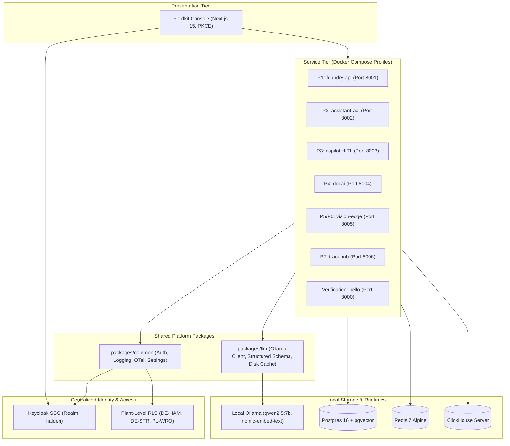

# Fieldkit

> **Forward-Deployed AI & Data Platform for Industrial Manufacturing**

Fieldkit is a production-grade, local-first enterprise AI platform built for forward-deployed engineering engagements. Designed around a realistic customer engagement (**Halden Industrie GmbH**, a German hydraulic components manufacturer), Fieldkit unifies data fusion, hybrid RAG, multi-agent operations, document intelligence, edge computer vision, and air-gapped deployment into a single coherent system.

---

## Architecture Overview



---

## Architectural Trade-Offs

| Decision | Alternative Considered | Trade-Off & Rationale | ADR |
| :--- | :--- | :--- | :--- |
| **Local Ollama Only ($0 Stack)** | Paid APIs (OpenAI, Anthropic) | Eliminates cloud costs and data leak risks in air-gapped environments, but limits model size to local VRAM/CPU capability. | [ADR 0001](docs/decisions/0001-monorepo-and-tooling-architecture.md) |
| **Keycloak SSO + Plant RLS** | Custom JWT / SQLite Auth | Keycloak introduces ~500MB JVM footprint, but provides enterprise OIDC/PKCE compliance, LDAP federation, and multi-tenant plant isolation. | [ADR 0002](docs/decisions/0002-keycloak-sso-and-plant-level-rls.md) |
| **Fail-Closed Structured Output** | Loose prompting / raw strings | One-shot self-correction adds ~1.5s latency on bad outputs, but guarantees zero schema corruption in relational databases. | [ADR 0003](docs/decisions/0003-deterministic-first-llm-wrapper-and-fail-closed-validation.md) |
| **Compose Profiles per Project** | Monolithic container launch | Requires passing `P=<profile>`, but prevents overloading 16 GB developer laptops by only running needed containers. | [ADR 0001](docs/decisions/0001-monorepo-and-tooling-architecture.md) |

---

## Failure Modes & Mitigations

| Failure Mode | Root Cause | System Mitigation | Test Verification |
| :--- | :--- | :--- | :--- |
| **Schema Validation Error** | LLM emits malformed JSON or missing fields | Automatic one-shot retry appending Pydantic error trace. If retry fails, raises `LLMValidationError` and fails closed. | `test_structured_output_fail_closed_after_retry` |
| **Ollama Service Interruption** | Host crash, port conflict, or model reload | Client initiates 3 retries with exponential backoff and jitter (`0.5s * 2^attempt + jitter`). | `test_generate_retry_on_failure` |
| **Token Spoofing / Tampering** | Unauthorized caller presents bogus JWT | Signature validated against Keycloak JWKS (cached 10 min). Unauthorized requests rejected with HTTP 401. | `test_auth.py` |
| **Cross-Plant Data Leak** | User from `DE-STR` attempts to view `DE-HAM` | Middleware `current_principal(required_plant="...")` blocks request with HTTP 403 unless user is `admin`. | `test_current_principal_dependency_plant_rls` |
| **Conversational Stale State** | Chat user receives cached response from previous session | Setting `is_chat=True` explicitly bypasses disk cache read/write. | `test_chat_bypasses_cache` |

---

## Baseline Evaluation Metrics

Live benchmarks generated via `make eval P=hello` against local Ollama models (see [evals/reports/hello/2026-10-16.md](evals/reports/hello/2026-10-16.md)):

| Metric | Target | Measured Result | Status |
| :--- | :--- | :--- | :--- |
| **Schema Validity Rate** | 100% | **100.0%** (5/5 samples) | PASS |
| **Classification Accuracy** | ≥ 95% | **100.0%** | PASS |
| **Average Latency (Local 4B)** | < 5.0 s | **4.07 s** | PASS |
| **P95 Latency** | < 25.0 s | **20.36 s** | PASS |
| **Cache Hit Efficiency** | > 0% | **50.0%** | PASS |

---

## Architecture Decision Records (ADRs)
- [ADR 0001: Monorepo Architecture and Local-First Tooling](docs/decisions/0001-monorepo-and-tooling-architecture.md)
- [ADR 0002: Keycloak SSO Authentication, RBAC, and Plant-Level Row-Level Security (RLS)](docs/decisions/0002-keycloak-sso-and-plant-level-rls.md)
- [ADR 0003: Deterministic-First LLM Architecture and Fail-Closed Validation](docs/decisions/0003-deterministic-first-llm-wrapper-and-fail-closed-validation.md)

---

## Quickstart

### Prerequisites
- Python 3.12+ and `uv`
- Docker Desktop
- Ollama with `nomic-embed-text` and `qwen2.5:7b` (or `qwen3.5:4b`)
- Git Bash on Windows

### 1. Setup Workspace
```bash
make setup
```

### 2. Run Test & Quality Checks
```bash
make check
```

### 3. Run Benchmark Evaluations
```bash
make eval P=hello
```

### 4. Start Core Services with Profile
```bash
# Start core services (Postgres, Redis, Keycloak) plus verification service
make up P=hello
```

Endpoints:
- **Hello Service Docs**: [http://localhost:8000/docs](http://localhost:8000/docs)
- **Keycloak Admin**: [http://localhost:8080](http://localhost:8080) (admin / admin)
- **Postgres**: localhost:5432 (user: `fieldkit`, db: `fieldkit`)

---

## 2-Minute Demo Video
- **Recording Script**: See [docs/runbooks/demo-script.md](docs/runbooks/demo-script.md) for scene-by-scene walkthrough.
- **Video Link**: *Pending recording upload* — `https://youtu.be/fieldkit-phase0-demo` (Unlisted).
