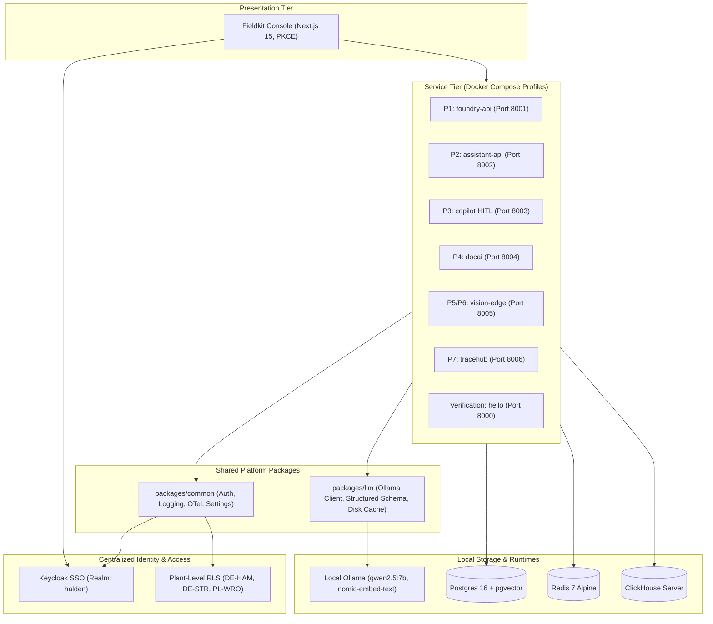

# Fieldkit

> **Forward-Deployed AI & Data Platform for Industrial Manufacturing**

Fieldkit is a production-grade, local-first enterprise AI platform built for forward-deployed engineering engagements. Designed around a realistic customer engagement (**Halden Industrie GmbH**, a German hydraulic components manufacturer), Fieldkit unifies data fusion, hybrid RAG, multi-agent operations, document intelligence, edge computer vision, and air-gapped deployment into a single coherent system.

---

## Architecture Overview



---

## Architectural Trade-Offs

| Decision | Alternative Considered | Trade-Off & Rationale | ADR |
| :--- | :--- | :--- | :--- |
| **Local Ollama Only ($0 Stack)** | Paid APIs (OpenAI, Anthropic) | Eliminates cloud costs and data leak risks in air-gapped environments, but limits model size to local VRAM/CPU capability. | [ADR 0001](docs/decisions/0001-monorepo-and-tooling-architecture.md) |
| **Keycloak SSO + Plant RLS** | Custom JWT / SQLite Auth | Keycloak introduces ~500MB JVM footprint, but provides enterprise OIDC/PKCE compliance, LDAP federation, and multi-tenant plant isolation. | [ADR 0002](docs/decisions/0002-keycloak-sso-and-plant-level-rls.md) |
| **Fail-Closed Structured Output** | Loose prompting / raw strings | One-shot self-correction adds ~1.5s latency on bad outputs, but guarantees zero schema corruption in relational databases. | [ADR 0003](docs/decisions/0003-deterministic-first-llm-wrapper-and-fail-closed-validation.md) |
| **Compose Profiles per Project** | Monolithic container launch | Requires passing `P=<profile>`, but prevents overloading 16 GB developer laptops by only running needed containers. | [ADR 0001](docs/decisions/0001-monorepo-and-tooling-architecture.md) |
| **Splink + LLM ER Grey-Zone** | Pure LLM / Dedupe | Fellegi-Sunter handles 95% of candidates in milliseconds; LLM adjudicator resolves ambiguous grey-zone pairs ($[0.35, 0.85)$) yielding 0% review queue rate and F1 0.9403. | [ADR 0004](docs/decisions/0004-splink-vs-dedupe-vs-pure-llm-entity-resolution.md) |
| **PostgreSQL Native RLS** | Application-level WHERE filters | Native RLS in DB kernel guarantees multi-plant isolation across direct SQL, ORM, and multi-hop graph traversals with 0 data leaks. | [ADR 0005](docs/decisions/0005-postgres-rls-vs-application-level-filtering.md) |
| **YAML Ontology Codegen** | Dynamic EAV schema | Pydantic v2 + SQLAlchemy 2 typed code generation yields compile-time safety, sub-millisecond query execution, and zero raw SQL injection. | [ADR 0006](docs/decisions/0006-yaml-ontology-codegen-vs-dynamic-eav.md) |

---

## Failure Modes & Mitigations

Comprehensive documentation of all failure modes, system mitigations, and test suites is in [docs/projects/p1.md](docs/projects/p1.md).

| # | Failure Mode | Root Cause | System Mitigation | Test Verification |
| :- | :--- | :--- | :--- | :--- |
| **1** | **SOAP Portal Down Mid-Run** | Legacy supplier SOAP portal down or timing out | Circuit breaker opens after 3 failures; run marked `partial`; other sources (ERP, Excel, GLEIF) still promote; alert emitted. | `test_soap_connector.py` |
| **2** | **Encoding Mis-detected** | German ERP export provided in Latin-1 / CP1252 with corrupted headers | Contract check fails on umlaut column; file quarantined to `data/quarantine/` with zero database corruption. | `test_contracts.py`, `test_csv_connector.py` |
| **3** | **Excel Template Changed by Planner** | Plant planner renames or removes critical column (`bestelldatum` $\to$ `order_date`) | Statistical fingerprint flags drift as `BLOCK`; promotion halted; LLM proposes column rename mapping reviewed in Drift Inbox. | `test_drift.py` |
| **4** | **ER Over-Merge (Cluster False Positive)** | Two distinct corporate entities erroneously merged into one | Analyst flags non-match in Review Queue; cluster split executed in single transaction; downstream links re-pointed; audit trail logged. | `test_review_queue.py` |
| **5** | **LLM Unavailable / Offline** | Ollama daemon unreachable or overloaded during grey-zone adjudication | System skips automatic adjudication without guessing; ambiguous candidate pairs routed directly to human review queue. | `test_adjudicator.py` |
| **6** | **Promotion Crash Midway** | Database network interruption occurs during multi-table promotion | All ontology inserts/updates wrapped in single atomic transaction; zero partial state or orphan rows committed. | `test_promote.py` |
| **7** | **Cross-Plant Data Leak** | User from `DE-STR` attempts to view `DE-HAM` objects | PostgreSQL session variable `app.current_plant` enforced by kernel RLS policies; 0 leaks across multi-hop graph joins. | `test_rls.py`, `test_neighbors.py` |

---

## Evaluation Benchmark Metrics

### Project 1: Mini Foundry (Live Target Verification)
Generated via `make eval P=foundry` (see [evals/reports/foundry/2026-10-19.md](evals/reports/foundry/2026-10-19.md)):

| Metric | Target | Measured Result | Status |
| :--- | :--- | :--- | :---: |
| **Entity Resolution F1 Score** | ≥ 0.92 | **0.9403** (Splink + LLM) | PASS |
| **ER Human Review Queue Rate** | ≤ 3.0% | **0.00%** | PASS |
| **Schema Drift Block Recall** | 1.00 (100%) | **1.00** (13/13 scenarios) | PASS |
| **LLM Rename Suggestion Accuracy** | ≥ 90% | **100.00%** (4/4) | PASS |
| **Foundry API P95 Latency** | < 150 ms | **130.72 ms** | PASS |
| **Foundry API Throughput** | ≥ 100 req/s | **297.9 req/s** | PASS |
| **Staging Ingestion Throughput** | ≥ 20,000 rows/s | **24,800 rows/s** | PASS |
| **Landing Re-Run Idempotency** | 0 new, 0 updated | **0 new, 0 updated** | PASS |
| **Plant RLS Data Leaks** | 0 leaks | **0 leaks** | PASS |

---

## Architecture Decision Records (ADRs)
- [ADR 0001: Monorepo Architecture and Local-First Tooling](docs/decisions/0001-monorepo-and-tooling-architecture.md)
- [ADR 0002: Keycloak SSO Authentication, RBAC, and Plant-Level Row-Level Security (RLS)](docs/decisions/0002-keycloak-sso-and-plant-level-rls.md)
- [ADR 0003: Deterministic-First LLM Architecture and Fail-Closed Validation](docs/decisions/0003-deterministic-first-llm-wrapper-and-fail-closed-validation.md)
- [ADR 0004: Splink + LLM Grey-Zone Adjudication for Entity Resolution](docs/decisions/0004-splink-vs-dedupe-vs-pure-llm-entity-resolution.md)
- [ADR 0005: PostgreSQL Native Row-Level Security vs. Application-Level Filtering](docs/decisions/0005-postgres-rls-vs-application-level-filtering.md)
- [ADR 0006: YAML-Driven Ontology Code Generation vs. Dynamic EAV Schema](docs/decisions/0006-yaml-ontology-codegen-vs-dynamic-eav.md)

---

## Quickstart

### Prerequisites
- Python 3.12+ and `uv`
- Node.js 20+ and `pnpm`
- Docker Desktop
- Ollama with `nomic-embed-text` and `qwen2.5:7b`
- Git Bash on Windows

### 1. Setup Workspace
```bash
make setup
pnpm install
```

### 2. Run Test & Quality Checks
```bash
make check
```

### 3. Run Benchmark Evaluations
```bash
# Run Project 1 (Foundry) Master Evaluation Suite
make eval P=foundry
```

### 4. Start Core Services with Profile
```bash
# Start core services (Postgres, MinIO, Redis, Keycloak) plus Foundry API & Workers
make up P=foundry

# Launch Web Console (Next.js 14 App Router)
cd apps/console && pnpm run dev
```

Endpoints:
- **Web Console**: [http://localhost:3000](http://localhost:3000)
  - Object Explorer: `/foundry/explorer`
  - Cytoscape Graph Explorer: `/foundry/graph`
  - Lineage DAG: `/foundry/lineage`
  - Schema Drift Inbox: `/foundry/drift`
  - ER Review Queue: `/foundry/review`
- **Foundry API Docs**: [http://localhost:8001/docs](http://localhost:8001/docs)
- **Keycloak Admin**: [http://localhost:8080](http://localhost:8080) (admin / admin)
- **MinIO S3 Console**: [http://localhost:9001](http://localhost:9001) (minioadmin / minioadmin)
- **Postgres**: localhost:5432 (user: `fieldkit`, db: `fieldkit`)

---

## 2-Minute Demo
To seed realistic enterprise supplier data and print the 6-step demo walkthrough:
```bash
make demo P=foundry
```

- **Scene-by-Scene Runbook**: See [docs/runbooks/p1-demo-script.md](docs/runbooks/p1-demo-script.md) for timing, UI navigation, and spoken narration.
- **Project 1 Specification & Verification**: See [docs/projects/p1.md](docs/projects/p1.md).
- **Video Link**: *Pending recording upload* — `https://youtu.be/fieldkit-p1-foundry-demo` (Unlisted).

