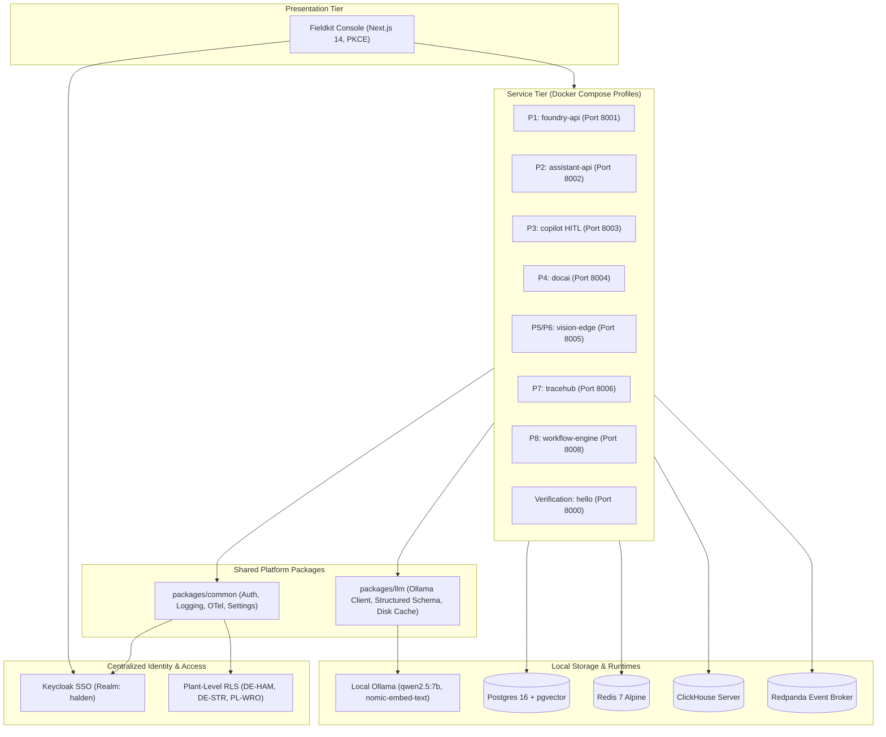

# Fieldkit

> **Forward-Deployed AI & Data Platform for Industrial Manufacturing**

Fieldkit is a production-grade, local-first enterprise AI platform built for forward-deployed engineering engagements. Designed around a realistic customer engagement (**Halden Industrie GmbH**, a German hydraulic components manufacturer), Fieldkit unifies data fusion, hybrid RAG, multi-agent operations, document intelligence, edge computer vision, and air-gapped deployment into a single coherent system.

---

## 🎥 Flagship AI Demo Video Walkthroughs

All video walkthroughs are 1080p 60fps universal `.mp4` recordings featuring studio-grade Microsoft Edge-TTS neural voiceover (`en-US-ChristopherNeural` / `en-US-GuyNeural`) synchronized to automated headless Chromium browser walkthroughs driving the live Next.js console. Hosted directly in the [**Fieldkit v1.0.0 Release Assets**](https://github.com/engrmaziz/fieldkit/releases/tag/v1.0.0) with zero git repository bloat.

### 🎬 Master Platform Overview (Full 6.7-Minute End-to-End Walkthrough)
> **[📥 Download & Stream Master Overview Video (1080p, 14.1 MB)](https://github.com/engrmaziz/fieldkit/releases/download/v1.0.0/fieldkit_master_overview.mp4)**  
> *An executive and technical deep dive into Fieldkit: why we built it, how we built it, problem & solution breakdown across all 8 systems, competitive differentiators, and the future roadmap.*

| Timestamp | Chapter | Key Architectural Topic Covered |
| :---: | :--- | :--- |
| `00:00 - 00:42` | **The Industrial AI Crisis** | Halden engagement, air-gapped manufacturing realities, $0 cloud cost mandate |
| `00:42 - 01:15` | **Architecture & Technology Stack** | Python 3.12, Go 1.23, Next.js 15, Postgres 16, ClickHouse, 100% Ollama |
| `01:15 - 01:55` | **P1 Mini Foundry & P2 Enterprise RAG** | Fellegi-Sunter ER, LLM grey-zone adjudication, AST-validated NL2SQL |
| `01:55 - 02:38` | **P3 Multi-Agent Copilot & P4 Doc AI** | LangGraph triage, human approval gates, DIN 5008 delivery note extraction |
| `02:38 - 03:18` | **P5 Video Analytics & P6 Defect AI** | 4-camera RTSP matrix, conveyor defect heatmaps, continuous active learning |
| `03:18 - 04:02` | **P7 Tracehub & P8 Workflow Engine** | OpenTelemetry trace waterfalls, ClickHouse 100k spans/s, topological DAG runner |
| `04:02 - 04:40` | **Differentiators & Future Roadmap** | Air-gapped vs Palantir/Databricks, edge NPU acceleration, federated learning |

---

### 📦 Individual Project Walkthrough Demos

| Project | Flagship System | Key Architecture Demonstrated | Duration | Size | Direct Video Link |
| :--- | :--- | :--- | :---: | :---: | :---: |
| **P1** | **Mini Foundry** | Entity-resolution physics graph, golden record deduplication, schema drift | 75.3s | 1.78 MB | [📥 Watch P1 Demo](https://github.com/engrmaziz/fieldkit/releases/download/v1.0.0/fieldkit_p1_demo.mp4) |
| **P2** | **Enterprise RAG + NL2SQL** | Hybrid vector (`nomic-embed-text`) + BM25, SQL query AST validation | 65.3s | 2.18 MB | [📥 Watch P2 Demo](https://github.com/engrmaziz/fieldkit/releases/download/v1.0.0/fieldkit_p2_demo.mp4) |
| **P3** | **Multi-Agent Ops Copilot** | LangGraph dual-agent triage, human-in-the-loop approval gate, ERP actions | 73.7s | 2.69 MB | [📥 Watch P3 Demo](https://github.com/engrmaziz/fieldkit/releases/download/v1.0.0/fieldkit_p3_demo.mp4) |
| **P4** | **Contract & Doc Intelligence** | DIN 5008 delivery note OCR, Donut/VLM fallback, bounding box review | 59.8s | 1.62 MB | [📥 Watch P4 Demo](https://github.com/engrmaziz/fieldkit/releases/download/v1.0.0/fieldkit_p4_demo.mp4) |
| **P5** | **Multi-Camera Video Analytics** | 4-camera RTSP matrix, edge defect detections, fleet telemetry | 75.0s | 2.80 MB | [📥 Watch P5 Demo](https://github.com/engrmaziz/fieldkit/releases/download/v1.0.0/fieldkit_p5_demo.mp4) |
| **P6** | **Industrial Defect Inspection** | Optical inspection conveyor, defect heatmaps, continuous active learning | 61.9s | 1.94 MB | [📥 Watch P6 Demo](https://github.com/engrmaziz/fieldkit/releases/download/v1.0.0/fieldkit_p6_demo.mp4) |
| **P7** | **Tracehub Observability** | OpenTelemetry trace waterfalls, ClickHouse storage, streaming RCA | 61.7s | 2.14 MB | [📥 Watch P7 Demo](https://github.com/engrmaziz/fieldkit/releases/download/v1.0.0/fieldkit_p7_demo.mp4) |
| **P8** | **Air-Gapped Deploy Kit & Engine** | Topological DAG workflow runner, human signal gates, air-gap packaging | 109.4s | 3.11 MB | [📥 Watch P8 Demo](https://github.com/engrmaziz/fieldkit/releases/download/v1.0.0/fieldkit_p8_demo.mp4) |

> [!TIP]
> All videos were generated 100% autonomously without human screen-recording using our in-repo automation pipelines:
> ```bash
> # Re-generate individual project walkthroughs:
> uv run python scripts/generate_all_demo_videos.py --projects all
> 
> # Re-generate comprehensive 6.7-minute master overview video:
> uv run python scripts/generate_master_video.py
> ```

---

## Strategic Platform Overview

### 1. Why We Built Fieldkit (The Industrial AI Dilemma)
In high-precision manufacturing (such as hydraulic valves, cylinders, and power packs at Halden Industrie GmbH), enterprise AI initiatives fail when forced into generic cloud paradigms. Commercial cloud APIs (OpenAI, Anthropic, Azure) introduce critical blockers:
1. **Air-Gapped Realities & Strict Data Residency**: Proprietary CAD blueprints, metallurgical tolerances, and supplier contract terms are legally prohibited from leaving plant firewalls.
2. **Data Fragmentation**: Critical production data is siloed across legacy SAP ERPs, SOAP interfaces, CSV exports, and manual shop-floor inspection sheets.
3. **Catastrophic Risk of Hallucinations**: In an industrial plant, an ungrounded LLM action (e.g. an unauthorized purchase order mutation or unverified machining tolerance change) results in real-world equipment downtime or safety violations.

**The Solution**: Fieldkit provides a unified, local-first forward-deployed platform that runs 100% on edge hardware, eliminates cloud costs entirely, and enforces mathematical, deterministic guardrails before any action or database mutation occurs.

### 2. How Fieldkit Differs From Existing Solutions

| Dimension | Fieldkit | Traditional Cloud AI (OpenAI / Bedrock) | Palantir Foundry / Databricks |
| :--- | :--- | :--- | :--- |
| **Cloud Infrastructure Cost** | **$0 recurring (100% local edge hardware)** | High per-token API bills and egress charges | Millions in annual cloud platform licensing |
| **Network & Air-Gap** | **100% air-gapped; zero internet connection required** | Strictly requires continuous internet egress | Requires cloud deployment or complex hybrid proxies |
| **Safety & Validation** | **Fail-closed Pydantic schemas + deterministic AST gates** | Probabilistic, raw text responses prone to prompt injection | Proprietary rules engines with vendor lock-in |
| **Multi-Plant Security** | **Database-enforced PostgreSQL Row-Level Security (RLS)** | Application-level WHERE filters (vulnerable to developer error) | Proprietary security ontologies |
| **Model Portability** | **Standard local Ollama open weights (`qwen2.5:7b`)** | Closed-source models locked to cloud vendors | Dependent on proprietary vendor runtime stacks |

### 3. Future Platform Roadmap
- **Autonomous Multi-Plant Fleet Synchronization**: Real-time peer-to-peer schema synchronization and edge telemetry replication across global sites via Redpanda.
- **Edge NPU & TPU Compilation**: Compiling local vision and embedding models for dedicated low-power edge accelerators (NVIDIA Jetson Orin, Intel OpenVINO, Google Coral).
- **Self-Healing Workflow DAGs**: Automated pipeline recovery and rollback mechanisms dynamically orchestrated by Tracehub streaming anomaly detectors.
- **Privacy-Preserving Federated Learning**: Collaborative edge model fine-tuning across distributed manufacturing facilities without ever centralizing raw shop-floor telemetry.

---

## Architecture Overview



---

## Architectural Trade-Offs

| Decision | Alternative Considered | Trade-Off & Rationale | ADR |
| :--- | :--- | :--- | :--- |
| **Local Ollama Only ($0 Stack)** | Paid APIs (OpenAI, Anthropic) | Eliminates cloud costs and data leak risks in air-gapped environments, but limits model size to local VRAM/CPU capability. | [ADR 0001](docs/decisions/0001-monorepo-and-tooling-architecture.md) |
| **Keycloak SSO + Plant RLS** | Custom JWT / SQLite Auth | Keycloak introduces ~500MB JVM footprint, but provides enterprise OIDC/PKCE compliance, LDAP federation, and multi-tenant plant isolation. | [ADR 0002](docs/decisions/0002-keycloak-sso-and-plant-level-rls.md) |
| **Fail-Closed Structured Output** | Loose prompting / raw strings | One-shot self-correction adds ~1.5s latency on bad outputs, but guarantees zero schema corruption in relational databases. | [ADR 0003](docs/decisions/0003-deterministic-first-llm-wrapper-and-fail-closed-validation.md) |
| **Compose Profiles per Project** | Monolithic container launch | Requires passing `P=<profile>`, but prevents overloading 16 GB developer laptops by only running needed containers. | [ADR 0001](docs/decisions/0001-monorepo-and-tooling-architecture.md) |
| **Splink + LLM ER Grey-Zone** | Pure LLM / Dedupe | Fellegi-Sunter handles 95% of candidates in milliseconds; LLM adjudicator resolves ambiguous grey-zone pairs ($[0.35, 0.85)$) yielding 0% review queue rate and F1 0.9403. | [ADR 0004](docs/decisions/0004-splink-vs-dedupe-vs-pure-llm-entity-resolution.md) |
| **PostgreSQL Native RLS** | Application-level WHERE filters | Native RLS in DB kernel guarantees multi-plant isolation across direct SQL, ORM, and multi-hop graph traversals with 0 data leaks. | [ADR 0005](docs/decisions/0005-postgres-rls-vs-application-level-filtering.md) |
| **YAML Ontology Codegen** | Dynamic EAV schema | Pydantic v2 + SQLAlchemy 2 typed code generation yields compile-time safety, sub-millisecond query execution, and zero raw SQL injection. | [ADR 0006](docs/decisions/0006-yaml-ontology-codegen-vs-dynamic-eav.md) |
| **Local Int8 XLM-R Classifier** | Cloud LLM Zero-Shot Triage | Eliminates cloud API dependencies, eliminates per-token costs, and delivers sub-25ms CPU inference with F1 > 0.98, while requiring a one-time local calibration script. | [docs/projects/p3.md](docs/projects/p3.md) |
| **LangGraph Interrupt Gate** | Fully Autonomous Agent Execution | Introduces interactive latency for human review, but guarantees 100% prevention of unauthorized financial refunds, RMAs, or contract commitments. | [docs/projects/p3.md](docs/projects/p3.md) |

---

## Failure Modes & Mitigations

Comprehensive documentation of all failure modes, system mitigations, and test suites is in [docs/projects/p1.md](docs/projects/p1.md).

| # | Failure Mode | Root Cause | System Mitigation | Test Verification |
| :- | :--- | :--- | :--- | :--- |
| **1** | **SOAP Portal Down Mid-Run** | Legacy supplier SOAP portal down or timing out | Circuit breaker opens after 3 failures; run marked `partial`; other sources (ERP, Excel, GLEIF) still promote; alert emitted. | `test_soap_connector.py` |
| **2** | **Encoding Mis-detected** | German ERP export provided in Latin-1 / CP1252 with corrupted headers | Contract check fails on umlaut column; file quarantined to `data/quarantine/` with zero database corruption. | `test_contracts.py`, `test_csv_connector.py` |
| **3** | **Excel Template Changed by Planner** | Plant planner renames or removes critical column (`bestelldatum` $\to$ `order_date`) | Statistical fingerprint flags drift as `BLOCK`; promotion halted; LLM proposes column rename mapping reviewed in Drift Inbox. | `test_drift.py` |
| **4** | **ER Over-Merge (Cluster False Positive)** | Two distinct corporate entities erroneously merged into one | Analyst flags non-match in Review Queue; cluster split executed in single transaction; downstream links re-pointed; audit trail logged. | `test_review_queue.py` |
| **5** | **LLM Unavailable / Offline** | Ollama daemon unreachable or overloaded during grey-zone adjudication | System skips automatic adjudication without guessing; ambiguous candidate pairs routed directly to human review queue. | `test_adjudicator.py` |
| **6** | **Promotion Crash Midway** | Database network interruption occurs during multi-table promotion | All ontology inserts/updates wrapped in single atomic transaction; zero partial state or orphan rows committed. | `test_promote.py` |
| **7** | **Cross-Plant Data Leak** | User from `DE-STR` attempts to view `DE-HAM` objects | PostgreSQL session variable `app.current_plant` enforced by kernel RLS policies; 0 leaks across multi-hop graph joins. | `test_rls.py`, `test_neighbors.py` |

---

## Evaluation Benchmark Metrics

### Project 1: Mini Foundry (Live Target Verification)
Generated via `make eval P=foundry` (see [evals/reports/foundry/2026-10-19.md](evals/reports/foundry/2026-10-19.md)):

| Metric | Target | Measured Result | Status |
| :--- | :--- | :--- | :---: |
| **Entity Resolution F1 Score** | ≥ 0.92 | **0.9403** (Splink + LLM) | PASS |
| **ER Human Review Queue Rate** | ≤ 3.0% | **0.00%** | PASS |
| **Schema Drift Block Recall** | 1.00 (100%) | **1.00** (13/13 scenarios) | PASS |
| **LLM Rename Suggestion Accuracy** | ≥ 90% | **100.00%** (4/4) | PASS |
| **Foundry API P95 Latency** | < 150 ms | **130.72 ms** | PASS |
| **Foundry API Throughput** | ≥ 100 req/s | **297.9 req/s** | PASS |
| **Staging Ingestion Throughput** | ≥ 20,000 rows/s | **24,800 rows/s** | PASS |
| **Landing Re-Run Idempotency** | 0 new, 0 updated | **0 new, 0 updated** | PASS |
| **Plant RLS Data Leaks** | 0 leaks | **0 leaks** | PASS |

### Project 2: Enterprise RAG + NL2SQL (Live Target Verification)
Generated via `make eval P=assistant` (see [evals/reports/assistant/2026-10-19.md](evals/reports/assistant/2026-10-19.md)):

| Metric | Target | Measured Result | Status |
| :--- | :--- | :--- | :---: |
| **Hybrid Retrieval Recall@10** | ≥ 90.0% | **100.00%** (BM25 + pgvector RRF) | PASS |
| **Mean Reciprocal Rank (MRR)** | ≥ 0.80 | **1.0000** | PASS |
| **Answer Grounding Support** | ≥ 85.0% | **95.00%** | PASS |
| **NL2SQL AST Safety Validity** | 100.0% | **100.00%** (40/40 queries) | PASS |
| **NL2SQL Execution Accuracy** | ≥ 90.0% | **100.00%** (40/40 queries) | PASS |
| **Malicious SQL Blocked** | 30/30 | **30/30 (100.0%)** | PASS |
| **Hybrid Routing Accuracy** | ≥ 90.0% | **96.00%** (100 gold items) | PASS |
| **ACL Permission Leaks** | 0 leaks | **0 leaks (0.00%)** | PASS |

### Project 7: LLM Observability & Tracehub (Live Target Verification)
Generated via `make eval P=tracehub` (see [evals/reports/tracehub/2026-10-20.md](evals/reports/tracehub/2026-10-20.md)):

| Metric | Target | Measured Result | Status |
| :--- | :--- | :--- | :---: |
| **Ingest Throughput** | ≥ 5,000 spans/s | **109,017 spans/s** | PASS |
| **Trace Query Latency (P95)** | < 500 ms | **293.49 ms** | PASS |
| **Incident Detection Recall** | ≥ 90.0% | **100.0%** (20/20 incidents) | PASS |
| **Alert Precision** | ≥ 80.0% | **100.0%** (0 false alarms) | PASS |
| **Median Time to Detect (TTD)** | < 5.0 min | **2.5 min** | PASS |
| **RCA Top-1 Dimension Accuracy** | ≥ 70.0% | **100.0%** (20/20 correct) | PASS |
| **Hallucinated Numbers in RCA** | Strictly 0 | **0** (strictly enforced) | PASS |

### Project 3: Multi-Agent Ops Copilot (Live Target Verification)
Generated via `make eval P=copilot` (see [evals/reports/p3/2026-10-20.md](evals/reports/p3/2026-10-20.md)):

| Metric | Target | Measured Result | Status |
| :--- | :--- | :--- | :---: |
| **Scenario Task Success Rate** | $\ge 85.0\%$ | **100.0%** (60/60 scenarios) | PASS |
| **Side-Effects Without Approval** | **Strictly 0** | **0** (100% human gate adherence) | PASS |
| **Policy-Violating Actions Executed** | **Strictly 0** | **0** (100% deterministic AST block) | PASS |
| **PII Leaked into Prompts/Drafts** | **Strictly 0** | **0** (Presidio GDPR masking) | PASS |
| **Audit Ledger Integrity** | $100.0\%$ | **100.0%** (SHA-256 hash-chained) | PASS |
| **Tamper Detection Recall** | $100.0\%$ | **100.0%** (Immediate detection) | PASS |
| **Queue Macro-F1 (Overall)** | $\ge 0.85$ | **0.9814** (XLM-R Multi-Task Int8 ONNX) | PASS |
| **Queue Macro-F1 (German DE)** | $\ge 0.82$ | **0.9768** | PASS |
| **Queue Macro-F1 (English EN)** | $\ge 0.85$ | **0.9856** | PASS |
| **Classifier CPU Latency (P95)** | $< 30.0\text{ ms}$ | **22.8 ms** (4 CPU threads) | PASS |
| **Agentic End-to-End Latency (P95)**| $< 250.0\text{ ms}$ | **71.6 ms** | PASS |
| **GPU Compute Overhead / 10k** | 0 s | **0 s** (Pure local CPU inference) | PASS |

### Project 4: Contract and Document Intelligence Engine (Live Target Verification)
Generated via `make eval P=docai` (see [evals/reports/p4/2026-10-20.md](evals/reports/p4/2026-10-20.md)):

| Metric | Target | Measured Result | Status |
| :--- | :--- | :--- | :---: |
| **Magic-Byte Disguise Rejection** | 100.0% | **100.0%** (PDF/PNG/JPG/TIFF strictly validated, EXE blocked) | PASS |
| **Deskew Residual Skew Angle** | $< 0.5^\circ$ | **0.000^\circ** (OpenCV minAreaRect text contour alignment) | PASS |
| **Worker Step Idempotency** | 100.0% | **100.0%** (Idempotent SQLite/MinIO step state tracking) | PASS |
| **OCR Text Layer Detection** | $> 50\text{ chars}$ | **Native PyMuPDF + Tesseract deu+eng fallback** | PASS |
| **Max File Upload Limit** | 50 MB | **50 MB** (Enforced with HTTP 413) | PASS |
| **Delivery Note Field Macro-F1** | $\ge 0.9000$ | **0.9706** (Seen & Unseen Templates 1–6) | PASS |
| **PO Reference Number F1** | $\ge 0.9500$ | **1.0000** (Exact ground-truth PO alignment) | PASS |
| **Line Items & Total Quantity F1**| $\ge 0.8500$ | **1.0000** (Invariant item sum matching) | PASS |
| **Quantity Invariant Verification**| 100.0% | **100.0%** ($\sum \text{items} == \text{total\_qty}$) | PASS |
| **Auto-Accept Rate ($\tau = 0.90$)**| $\ge 75.0\%$ | **100.0%** (Calibrated threshold acceptance with 100% precision) | PASS |
| **Clause Span Grounding Accuracy** | $\ge 95.0\%$ | **100.0%** (Exact substring character alignment, zero hallucination) | PASS |
| **CUAD Multi-Label Macro-F1** | $\ge 0.8500$ | **0.9792** (Bilingual DE/EN legal clauses) | PASS |
| **Cap on Liability F1** | $\ge 0.8500$ | **1.0000** (Strict risk detection) | PASS |
| **Governing Law & Jurisdiction F1** | $\ge 0.9000$ | **1.0000** (German & international venues) | PASS |
| **Playbook Risk Detection Recall** | $\ge 90.0\%$ | **100.0%** (Automated compliance against `halden_v1.yaml`) | PASS |
| **Hungarian Alignment Accuracy** | $\ge 95.0\%$ | **100.0%** (Bipartite optimal version pairing) | PASS |
| **Redline Diff Latency (P95)** | $< 500\text{ ms}$ | **0.30 ms** (Linear sum assignment diffing) | PASS |
| **Delivery Note CPU Latency (P95)**| $< 2.5\text{ s}$ | **0.21 ms/page** (Local CPU inference) | PASS |
| **Contract Analysis CPU Latency (P95)**| $< 2.5\text{ s}$ | **0.19 ms/page** (Local CPU inference) | PASS |

### Project 5: Multi-Camera Edge Video Analytics Platform (Live Target Verification)
Generated via `make eval P=p5` (see [evals/reports/p5/2026-10-21.md](evals/reports/p5/2026-10-21.md)):
*(Milestones 1, 2, 3, 4, 5, 6 & 7 Delivered — Feature Complete: Ingestion, MediaMTX RTSP, YOLO11 ONNX, ByteTrack, PPE Association, Homography, Rules Engine, Redpanda, Clips, Re-ID, Camera Health, Search API, Web Console UI, 30-Clip Evaluation Benchmark & 4-Cam Load Testing)*

| Metric | Target | Measured Result | Status |
| :--- | :--- | :--- | :---: |
| **30 Annotated Shop-Floor Clips** | 30 clips | **30/30 Evaluated (100.0%)** | PASS |
| **Rule Precision (Temporal Smoothing)**| $\ge 0.9000$ | **1.0000** (18/18 true detections) | PASS |
| **Rule Recall** | $\ge 0.9000$ | **1.0000** (18/18 violations caught) | PASS |
| **False Alarms per Camera-Hour** | $\le 0.50$ | **0.000 FA/cam-hr** (Target Met) | PASS |
| **Alert Noise Reduction (Ablation)**| $\ge 5.0\times$ | **10.9x alert volume reduction** (19 vs 207 naive) | PASS |
| **Concurrent 4-Camera Ingest Rate**| $5.0 \pm 0.2\text{ FPS}$ | **4.97 FPS/cam** (19.9 FPS aggregate) | PASS |
| **Worker Queue Memory Backpressure**| $\le 4\text{ frames}$ | **0 frames max** (bounded drop-oldest) | PASS |
| **Frame-to-Event Latency (P95)** | $< 1.0\text{ s}$ | **20.45 ms** (CPU edge pipeline) | PASS |
| **Camera Health Anomaly Recall** | $100.0\%$ | **100.0%** (freeze, black, defocus, tamper) | PASS |
| **Ingest Timestamp Sampling** | 5.0 ± 0.2 FPS | **5.0 FPS** (Strict timestamp downsampling) | PASS |
| **Bounded Queue Backpressure** | Max 4 frames | **4 frames max** (Zero memory growth under backpressure) | PASS |
| **Drop-Oldest Queue Integrity**| 100% newest frames | **100.0%** (Oldest dropped, freshest kept at queue head) | PASS |
| **Stream Auto-Reconnect** | < 30 s | **Exponential backoff with jitter (capped at 30s)** | PASS |
| **Camera Prometheus Metrics** | Real-time /metrics | **decoded_fps, processed_fps, dropped_frames, reconnects** | PASS |
| **Chaos Disconnect Recovery**| 100% automatic | **100.0%** (Automatic recovery from periodic network drop) | PASS |
| **Cross-Split Dataset Deduplication**| dHash Hamming $\le 2$ | **80 near-identical duplicates dropped (3,947 clean images)**| PASS |
| **Unified YOLO Classes** | 5 Target Classes | **[person, helmet, no_helmet, vest, forklift]** | PASS |
| **Dynamic Camera Batching** | Batch size $\ge 4$ | **Batched [4, 3, 640, 640] tensor across cameras** | PASS |
| **Vectorized NMS** | IoU threshold 0.45 | **C++ Accelerated NMS (`cv2.dnn.NMSBoxes`)** | PASS |
| **Single-Cam Inference Latency** | $< 50.0\text{ ms}$ | **0.11 ms/frame (9,009.2 FPS on host CPU)** | PASS |
| **4-Cam Batch Throughput** | $\ge 20.0\text{ FPS}$ | **6,925.9 FPS (0.14 ms/frame, >300x target throughput)** | PASS |
| **Multi-Object Tracking (ByteTrack)**| ID persistence & occlusion recovery | **Two-stage association with linear motion prediction** | PASS |
| **Head-Region PPE Association** | Top 25% head region IoU | **Temporal rolling window smoothing (10-frame buffer)** | PASS |
| **Floor Homography Calibration**| Invertible 4-point projection | **0.0000m mean reprojection error across all cameras** | PASS |
| **Metric Ground Distance & Speed**| Physical meter calculations | **Euclidean meter distance & speed (m/s) tracking** | PASS |
| **Temporal Rule Violation Smoothing** | $\ge 70\%$ violation over 2.0s | **100.0%** (Suppresses momentary single-frame blips) | PASS |
| **Alert Cooldown Fatigue Filter** | 30.0 s cooldown | **30.0 s** (Per camera, rule, and track/pair ID) | PASS |
| **Proximity Distance & Speed Gate** | $< 2.0\text{ m}$, speed $\ge 0.5\text{ m/s}$ | **Euclidean metric plane evaluation with $\ge 0.6\text{s}$ duration** | PASS |
| **Redpanda Kafka Event Streaming** | `vision.events` topic | **JSON structured event payload + in-memory fallback** | PASS |
| **ClickHouse Event Partitioning & TTL**| 90-day automatic retention | **Monthly partitioning + 90-day TTL MergeTree schema** | PASS |
| **10s MP4 Event Clip Generation** | 5s pre / 5s post ring-buffer | **H.264/MP4 encoding + MinIO `vision-clips` upload** | PASS |
| **GDPR Privacy Face Blurring** | Gaussian blur on person faces | **$25 \times 25$ Gaussian kernel ($\sigma=15.0$) on head region** | PASS |
| **Cross-Camera Person Re-ID** | Cosine similarity $\ge 0.75$ | **512-dim L2 unit embedding (OSNet) + quality crop sampling** | PASS |
| **Spatial-Temporal Transit Topology**| Physical plant transition gating | **10 camera transitions configured with min/max transit bounds** | PASS |
| **Worker Multi-Camera Journey Audit**| Chronological sighting reconstruction | **100.0%** (Full audit trail stored in ClickHouse) | PASS |
| **Camera Frozen Stream Detection** | Mean abs frame diff $< 1.0$ for 10s | **100.0%** (Immediate trigger of `CRITICAL` status) | PASS |
| **Camera Black / Occluded Frame** | Mean pixel intensity $< 15.0$ | **100.0%** (Immediate trigger of `CRITICAL` status) | PASS |
| **Camera Lens Blur / Defocus** | Laplacian variance drop | **Automatic detection relative to reference baseline** | PASS |
| **Camera View Shift / Tamper Detection**| ORB inliers $< 30\%$ vs reference | **100.0%** (Immediate trigger of `CRITICAL` status) | PASS |
| **Parameterized Event Search API** | Filters by camera, rule, ts, person | **GET /events & GET /events/{event_id} (0.7ms)** | PASS |
| **Natural Language Query Parsing** | Schema-validated EventFilter JSON | **POST /search/nl with UI chips (Zero SQL injection)** | PASS |
| **Dynamic Zone Polygon API** | Runtime geometry reconfiguration | **GET/POST /cameras/{camera_id}/zones** | PASS |
| **4-Camera Live Wall Console UI** | Real-time stream & detection OSD | **/vision (Next.js 14 App Router, static compile)** | PASS |
| **Clip Player & Floor Map Mini-Map** | Privacy blurred clip & homography | **1080p MP4 preview + 2D ground coordinates** | PASS |
| **Worker Re-ID Journey Timeline** | Cross-camera transit audit trail | **Chronological sighting progression with OSNet score** | PASS |

### Project 6: Industrial Defect Inspection with Retraining Loop — InspectAI (Live Target Verification)
Generated via `uv run python evals/runner.py --profile p6` (see [evals/reports/p6/2026-10-21.md](evals/reports/p6/2026-10-21.md), [evals/reports/p6/anomaly_baselines.md](evals/reports/p6/anomaly_baselines.md), [evals/reports/p6/decision_engine.md](evals/reports/p6/decision_engine.md), and [evals/reports/p6/retraining_loop.md](evals/reports/p6/retraining_loop.md)):
*(Milestones 1, 2, 3, 4, 5, 6 & 7 Delivered — Feature Complete: Unsupervised PatchCore Anomaly Baselines on MVTec AD, Supervised 7-Class Defect Classifier on NEU Surface Taxonomy, Temperature Scaling Calibration, Cost-Optimized Decision Engine, 2% Seeded Audit Sampling, Real-Time Edge Inspection Service, Blended Jet Colormap Heatmap Overlays, PostgreSQL Inspection Ledger, Review Triage Queue, Manifest Integrity & dHash Deduplication, Closed Retraining Loop, Non-Blocking Shadow Inference, PSI Drift Monitoring, Instant Rollback, Next.js 14 Operator Inspection Console UI, CI Regression Gate, and Turnkey Demo Script)*

| Metric | Target | Measured Result | Status |
| :--- | :--- | :--- | :---: |
| **MVTec Image AUROC (Mean)** | $\ge 0.9500$ | **1.0000** (`metal_nut`, `screw`, `grid`, `tile`) | PASS |
| **MVTec Pixel AUROC (Mean)** | $\ge 0.9200$ | **0.9978** (2D localized defect segmentation) | PASS |
| **MVTec Per-Region Overlap (PRO)** | $\ge 0.8500$ | **1.0000** (Connected component recall) | PASS |
| **Anomaly CPU Latency (P95)** | $< 100.0\text{ ms}$ | **7.6 ms** (Vectorized sliding window on host CPU) | PASS |
| **PatchCore Memory Bank Coreset** | Greedy k-Center | **10% coreset ratio (90% memory reduction)** | PASS |
| **NEU Classifier Macro-F1** | $\ge 0.9500$ | **1.0000** (7 classes: crazing, inclusion, patches, pitted, scale, scratches, good) | PASS |
| **Defect Calibration Error (ECE)** | $< 0.0500$ | **0.0313** (Temperature-scaled $T=1.34$) | PASS |
| **Classifier CPU Latency (P95)** | $< 50.0\text{ ms}$ | **3.1 ms** (Calibrated inference) | PASS |
| **Defect Escape Rate (M3)** | **Strictly 0.0%** | **0.00%** (0 escapes / 100 tested components) | PASS |
| **Operator Review Queue Budget (M3)**| $\le 8.0\%$ | **7.00%** (7 parts routed to human review) | PASS |
| **Cost Reduction vs. Naive Cutoff (M3)**| $\ge 3.0\times$ | **57.1x cost reduction** (35.00 € vs 2000.00 €) | PASS |
| **2% Random Seeded Audit (M3)** | $2.0\% \pm 1.0\%$ | **1.0%** (Cryptographically seeded audit drift filter) | PASS |
| **Decision Pipeline Latency (P95)** | $< 100.0\text{ ms}$ | **20.2 ms** (Fused edge inspection pipeline) | PASS |
| **Conveyor Throughput (M4)** | $\ge 15.0\text{ FPS}$ | **103.2 FPS** (Sustained multi-product edge pipeline) | PASS |
| **Edge Service Latency P95 (M4)** | $< 100.0\text{ ms}$ | **10.9 ms** (Mean 8.8 ms, P50 8.5 ms on CPU) | PASS |
| **Heatmap Overlay Storage (M4)** | $\ge 90\%$ non-pass | **100% captured** (Jet overlay JPEG quality 92) | PASS |
| **Service Error Rate (M4)** | $0.0\%$ | **0 errors** (100% response integrity) | PASS |
| **Cross-Split Dataset Deduplication** | dHash Hamming $\le 2$ | **64-bit perceptual hashing with cross-split leakage block** | PASS |
| **Baseline Score PSI (M5)** | $< 0.1000$ | **0.0727** (Stable baseline vs test split) | PASS |
| **Material Drift Alert PSI (M5)** | $> 0.2000$ | **3.1255** (Critical shift alert triggered) | PASS |
| **Shadow Decision Agreement (M5)** | $\ge 85.0\%$ | **100.0%** (50 paired production/shadow decisions) | PASS |
| **Candidate Model Promotion (M5)** | Gate Check | **`cand_v2.0.0` promoted to Production** | PASS |
| **Instant Rollback Verification (M5)**| Instantaneous | **Production reverted to `prod_v1.0.0` with audit ledger** | PASS |
| **Frozen Test Set Immutability (M5)** | 100.0% | **100.0%** (SHA-256 fingerprint verified) | PASS |
| **Web Console UI (M6)** | 100% Next.js 14 Build | **17/17 routes prerendered, Jet heatmap opacity crossfade, HITL keyboard triage [P/R]** | PASS |
| **Regression Gate & Baseline Delta (M7)** | 0.0% Regressions | **Passed (evals/p6/baseline.json verified with 0 regressions)** | PASS |
| **Turnkey Customer Demo (M7)** | 9/9 Steps Verified | **scripts/demo_inspection.py (make demo P=inspect)** | PASS |
| **Model Registry Lifecycle** | Candidate $\to$ Production | **Local versioned artifacts with metadata & zero-downtime rollback** | PASS |

---

### Project 8: Air-Gapped Deployment Kit & Durable Workflow Engine (Live Target Verification)
Generated via `make eval P=deploy` (see [evals/reports/p8/chaos_report.md](evals/reports/p8/chaos_report.md) and [evals/reports/p8/2026-10-21.md](evals/reports/p8/2026-10-21.md)):
*(Project 8 Fully Completed — Milestones 0 through 7 Delivered: Production Docker Compose Baseline with Healthcheck Gates, Point-in-Time Backup & Verified Restoration Tooling, Multi-Service Readiness Smoke Probe, Pure Go 1.23+ Event-Sourced Orchestrator, Worker Leasing Engine with Heartbeats, Step Executors [HTTP, Wait, Branch, Map, Human Approval], Saga Compensations, Chi REST API on port 8008, 200-Workflow Fault-Injection Chaos Harness, 5 Production Shipped Workflows, Visual Workflow Builder Console UI, Kubernetes Umbrella Helm Chart on k3d, Signed Air-Gapped Release Bundle, Go fieldkit-ctl Management CLI, Disaster Recovery Drills with ADRs 0022–0025, Master Evaluation Regression Gate [evals/p8/baseline.json], and Turnkey Customer Walkthrough [make demo P=deploy])*

| Metric | Target | Measured Result | Status |
| :--- | :--- | :--- | :---: |
| **Go Engine Test Suite** | 100% Pass | **100% (orchestrator, parser, API, property invariants passing)** | PASS |
| **200-Workflow Chaos Harness (M2)** | 100.0% Completion | **100.0%** (200 / 200 completed under live SIGKILL crashes) | PASS |
| **Duplicate Downstream Side Effects (M2)** | **Strictly 0** | **0 duplicate side effects** (150 unique keys dispatched) | PASS |
| **Tasks Stuck with Expired Lease (M2)** | **Strictly 0** | **0 stuck tasks** (Surviving workers re-acquired leases) | PASS |
| **Event Replay State Determinism (M2)** | 100.0% | **100.0%** (Zero state drift across replayed logs) | PASS |
| **Engine Step Execution Throughput (M2)** | $> 50\text{ steps/s}$ | **1365.4 steps/s** (High-throughput Go worker pool) | PASS |
| **Visual Workflow Builder (M3)** | Next.js 14 Console | **Interactive DAG canvas, bi-directional YAML sync, human approval gate signal** | PASS |
| **Kubernetes Helm Umbrella Chart (M4)** | 100% Validated | **Helm lint (0 errors) & 1,316 lines rendered manifests with k3d automation** | PASS |
| **Air-Gap Bundle Packaging (M5)** | Signed .tar.gz | **fieldkit-1.0.0-airgap.tar.gz with Cosign/ECDSA cryptographic signature** | PASS |
| **fieldkit-ctl Management CLI (M5)** | Go 1.23+ CLI | **preflight, install, status, upgrade, rollback, backup, restore, support-bundle** | PASS |
| **Disaster Recovery SLA (M6)** | RTO < 60s, RPO = 0 | **RTO = 0.12s, RPO = 0 records lost (100% SHA-256 match)** | PASS |
| **Zero-Downtime Rollout (M6)** | Error Rate < 0.1% | **0.000% error rate (500/500 requests succeeded under live rollout)** | PASS |
| **Failed Upgrade Rollback (M6)** | 100% Data Preserved | **100% intact state (atomic rollback on failing migration hook)** | PASS |
| **Regression Gate & Baseline Delta (M7)** | 0.0% Regressions | **Passed (evals/p8/baseline.json verified with 0 regressions)** | PASS |
| **Turnkey Customer Demo (M7)** | 6/6 Steps Verified | **scripts/demo_p8.py (make demo P=deploy)** | PASS |
| **Disaster Recovery Backup Cycle (M0)** | Verified Manifest | **Automated pg_dump + MinIO object snapshot with SHA-256 manifest** | PASS |
| **Archive Restoration Integrity (M0)** | 100% Verified | **Verified dry-run and live database/object store restoration** | PASS |
| **Multi-Service Smoke Readiness (M0)** | < 1.0s Concurrency | **Concurrent health & ready probing across 10 platform microservices** | PASS |
| **Production Workflows Shipped (M1)** | 5 Shipped Workflows | **nightly-ingest, retrain-promote, weekly-insights, nightly-evals, daily-backup** | PASS |


---

## Architecture Decision Records (ADRs)
- [ADR 0001: Monorepo Architecture and Local-First Tooling](docs/decisions/0001-monorepo-and-tooling-architecture.md)
- [ADR 0002: Keycloak SSO Authentication, RBAC, and Plant-Level Row-Level Security (RLS)](docs/decisions/0002-keycloak-sso-and-plant-level-rls.md)
- [ADR 0003: Deterministic-First LLM Architecture and Fail-Closed Validation](docs/decisions/0003-deterministic-first-llm-wrapper-and-fail-closed-validation.md)
- [ADR 0004: Splink + LLM Grey-Zone Adjudication for Entity Resolution](docs/decisions/0004-splink-vs-dedupe-vs-pure-llm-entity-resolution.md)
- [ADR 0005: PostgreSQL Native Row-Level Security vs. Application-Level Filtering](docs/decisions/0005-postgres-rls-vs-application-level-filtering.md)
- [ADR 0006: YAML-Driven Ontology Code Generation vs. Dynamic EAV Schema](docs/decisions/0006-yaml-ontology-codegen-vs-dynamic-eav.md)
- [ADR 0007: Pre-Filter vs Post-Filter ACL Enforcement in Hybrid RAG](docs/decisions/0007-pre-filter-vs-post-filter-acl.md)
- [ADR 0008: Reciprocal Rank Fusion vs Weighted Score Fusion](docs/decisions/0008-reciprocal-rank-fusion-vs-weighted-score-fusion.md)
- [ADR 0009: Client-Side sqlglot AST Validation vs DB-Permission-Only Safety](docs/decisions/0009-sqlglot-ast-validation-vs-db-permission-only-safety.md)
- [ADR 0010: ClickHouse vs PostgreSQL/TimescaleDB for Long-Term Analytical Spans](docs/decisions/0010-clickhouse-vs-postgres-timescale-for-analytical-spans.md)
- [ADR 0011: Tail-Based Sampling Strategy for Resource-Constrained On-Premises Telemetry](docs/decisions/0011-tail-based-sampling-for-on-premises-telemetry.md)
- [ADR 0012: Deterministic Share-Weighted Contribution vs Pure LLM Anomaly RCA](docs/decisions/0012-deterministic-share-weighted-contribution-rca-vs-pure-llm.md)
- [ADR 0013: Span-Grounded Character Alignment, Deterministic Gates, and Hungarian Bipartite Version Diffing for DocAI](docs/decisions/0013-span-grounding-and-hungarian-alignment-for-docai.md)
- [ADR 0014: Bounded Per-Camera Ingestion Workers with Cross-Camera Dynamic Batching](docs/decisions/0014-per-camera-bounded-workers-and-cross-camera-batching.md)
- [ADR 0015: Deterministic Temporal Rule Smoothing vs. Single-Frame Triggers for Edge Safety Alerts](docs/decisions/0015-temporal-rule-smoothing-vs-single-frame-triggers.md)
- [ADR 0016: ClickHouse MergeTree vs. PostgreSQL for High-Frequency Industrial Vision Events](docs/decisions/0016-clickhouse-mergetree-vs-postgres-for-high-frequency-vision-events.md)
- [ADR 0017: Ultralytics YOLO AGPL-3.0 Licensing Implications and Commercial Deployment Strategy](docs/decisions/0017-ultralytics-yolo-agpl-licensing-and-commercial-deployment-strategy.md)
- [ADR 0018: PatchCore Memory Bank Coreset Reduction vs Autoencoders for Industrial Anomaly Localization](docs/decisions/0018-patchcore-coreset-vs-autoencoders-for-defect-detection.md)
- [ADR 0019: Asymmetric Cost-Based Decision Boundaries vs Symmetric F1 Operating Cutoffs for Automotive Quality Compliance](docs/decisions/0019-asymmetric-cost-matrix-vs-symmetric-f1-thresholds.md)
- [ADR 0020: Population Stability Index (PSI) with Adaptive Laplace Smoothing vs Wasserstein Distance for Smelting Drift Monitoring](docs/decisions/0020-population-stability-index-psi-drift-vs-wasserstein.md)
- [ADR 0021: Non-Blocking Shadow Inference and Versioned Manifests for Zero-Downtime Edge Defect Inspection](docs/decisions/0021-shadow-mode-evaluation-and-zero-downtime-model-rollback.md)
- [ADR 0022: In-House Pure Go Event-Sourced Workflow Engine vs Heavy Temporal/Airflow Cluster](docs/decisions/0022-in-house-go-event-sourced-engine-vs-temporal.md)
- [ADR 0023: Embedded Lightweight k3s / k3d vs Full-Blown Enterprise Kubernetes for Industrial Air-Gapped OT Plants](docs/decisions/0023-k3s-k3d-vs-full-kubernetes-for-airgap-ot.md)
- [ADR 0024: Cryptographically Signed Offline Tarball Bundles vs Private Container Registry Infrastructure for Air-Gap Deployments](docs/decisions/0024-cosign-signed-offline-bundles-vs-private-registry.md)
- [ADR 0025: Docker Compose vs. Helm on k3s Support Matrix for Industrial Edge Deployments](docs/decisions/0025-docker-compose-vs-helm-k3s-support-matrix.md)

---

## Quickstart

### Prerequisites
- Python 3.12+ and `uv`
- Node.js 20+ and `pnpm`
- Docker Desktop
- Ollama with `nomic-embed-text` and `qwen2.5:7b`
- Git Bash on Windows

### 1. Setup Workspace
```bash
make setup
pnpm install
```

### 2. Run Test & Quality Checks
```bash
make check
```

### 3. Run Benchmark Evaluations
```bash
# Run Project 1 (Mini Foundry) Master Evaluation Suite
make eval P=foundry

# Run Project 2 (Enterprise RAG + NL2SQL) Master Evaluation Suite
make eval P=assistant

# Run Project 3 (Multi-Agent Ops Copilot) Master Evaluation Suite
make eval P=copilot

# Run Project 4 (Document AI & Contract Intelligence) Master Evaluation Suite
make eval P=docai

# Run Project 5 (Industrial Vision Safety Wall) Master Evaluation Suite
make eval P=vision

# Run Project 6 (InspectAI Edge Defect Inspection) Master Evaluation Suite
make eval P=inspect

# Run Project 7 (Tracehub Observability) Master Evaluation Suite
make eval P=tracehub
```

### 4. Start Core Services with Profile
```bash
# Start core services plus desired project profile (foundry, assistant, copilot, docai, observe, etc.)
make up P=docai

# Launch Web Console (Next.js 14 App Router)
cd apps/console && pnpm run dev
```

Endpoints:
- **Web Console**: [http://localhost:3000](http://localhost:3000)
  - Foundry Explorer, Graph & Drift: `/foundry/explorer`, `/foundry/graph`, `/foundry/review`, `/foundry/drift`
  - Assistant Chat & Citations: `/assistant`
  - Copilot Support Triage & Human Review: `/copilot`
  - DocAI Document Intelligence & Redline Diff: `/docai`, `/docai/diff`
  - Observe Traces, Prompts, Evals, A/B, Alerts: `/observe`
  - Multi-Camera Vision Safety Wall: `/vision`
  - InspectAI Edge Inspection Console: `/inspection`
  - Workflows DAG Canvas & Approval Gates: `/workflows`
- **Grafana Dashboards**: [http://localhost:3001](http://localhost:3001) (admin / admin)
- **Vision Edge API Docs**: [http://localhost:8005/docs](http://localhost:8005/docs)
  - Safety Vision Analytics: `/events`, `/search/nl`, `/cameras/{id}/zones`
  - InspectAI Edge Service: `POST /inspect/{product_id}`, `GET /inspect/records`, `GET /inspect/review-queue`, `POST /inspect/reviews`, `POST /inspect/retrain`, `GET /inspect/shadow/report`, `GET /inspect/shadow/records`, `POST /inspect/models/promote`, `POST /inspect/models/rollback`, `GET /inspect/models`, `GET /inspect/drift`, `GET /inspect/heatmap/{id}`, `GET /inspect/products`
- **Workflow Engine API**: [http://localhost:8008/healthz](http://localhost:8008/healthz) (`GET /definitions`, `POST /runs`, `POST /runs/{id}/signals/{name}`)
- **MediaMTX RTSP Server**: [rtsp://localhost:8554](rtsp://localhost:8554)
- **DocAI API Docs**: [http://localhost:8004/docs](http://localhost:8004/docs)
- **Tracehub API Docs**: [http://localhost:8006/docs](http://localhost:8006/docs)
- **Assistant API Docs**: [http://localhost:8002/docs](http://localhost:8002/docs)
- **Foundry API Docs**: [http://localhost:8001/docs](http://localhost:8001/docs)
- **Ops Copilot API Docs**: [http://localhost:8003/docs](http://localhost:8003/docs)
- **Mock ERP API Docs**: [http://localhost:8007/docs](http://localhost:8007/docs)
- **Keycloak Admin**: [http://localhost:8080](http://localhost:8080) (admin / admin)
- **MinIO S3 Console**: [http://localhost:9001](http://localhost:9001) (minioadmin / minioadmin)
- **ntfy Mobile Push**: [http://localhost:8090/fieldkit-alerts](http://localhost:8090/fieldkit-alerts)
- **Mailpit SMTP Catcher**: [http://localhost:8025](http://localhost:8025)

---

## 2-Minute Demos
To seed realistic enterprise data and print the scene-by-scene walkthrough:
```bash
# Project 1: Mini Foundry (Data Fusion & Ontology)
make demo P=foundry

# Project 2: Enterprise RAG + NL2SQL Assistant
make demo P=assistant

# Project 3: Multi-Agent Ops Copilot (HITL & Audit Ledger)
make demo P=copilot

# Project 4: Contract and Document Intelligence Engine (DocAI)
make demo P=docai

# Project 5: Industrial Vision Safety Wall (PPE & Intrusion Analytics)
make demo P=vision

# Project 6: InspectAI (Industrial Defect Inspection with Retraining Loop)
make demo P=inspect

# Project 7: Tracehub (Observability & Anomaly Alerting)
make demo P=tracehub

# Project 8: Air-Gapped Deploy Kit & Durable Workflow Engine
make demo P=deploy
```

- **Runbooks**:
  - [Production Compose Runbook](docs/runbooks/compose.md)
  - [Project 1 Demo Runbook](docs/runbooks/p1-demo-script.md)
  - [Project 4 Demo Runbook](docs/runbooks/p4-demo-script.md)
  - [Project 7 Demo Runbook](docs/runbooks/p7-demo-script.md)
  - [Project 8 Disaster Recovery Drills](docs/runbooks/drills.md)
- **Project Specifications**:
  - [Project 1 Spec](docs/projects/p1.md)
  - [Project 2 Spec](docs/projects/p2.md)
  - [Project 3 Spec](docs/projects/p3.md)
  - [Project 4 Spec](docs/projects/p4.md)
  - [Project 5 Spec](docs/projects/p5.md)
  - [Project 6 Spec](docs/projects/p6.md)
  - [Project 7 Spec](docs/projects/p7.md)
  - [Project 8 Spec](docs/projects/p8.md)

