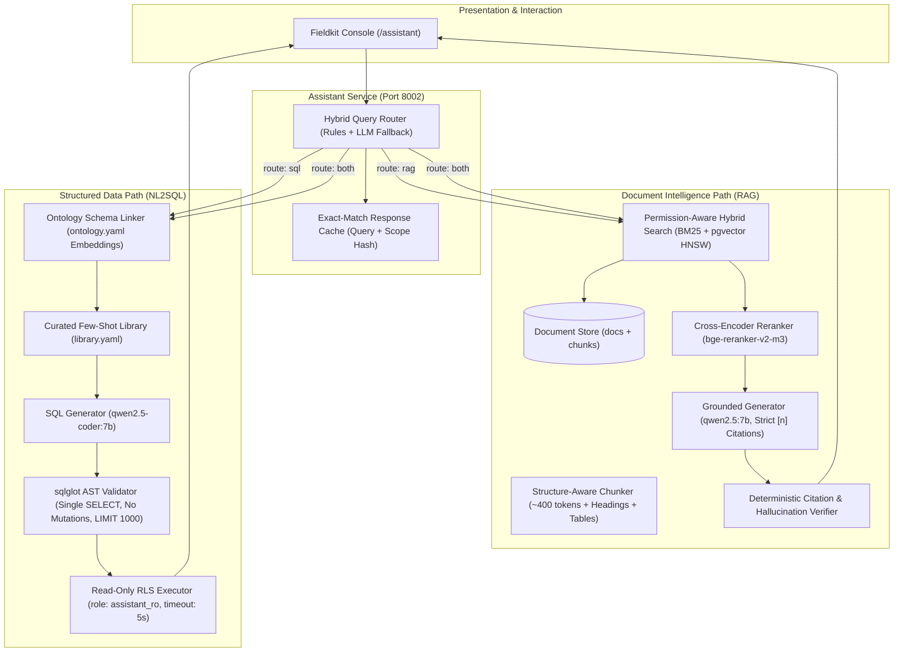

# Project 2: Enterprise RAG + NL2SQL Assistant with Evals

> **Customer Engagement**: Halden Industrie GmbH (Technical Operations, Legal & Procurement)  
> **Status**: In Progress — Milestone 1 (Corpus, ACLs, Ingestion)  
> **Guiding Principle**: Permission-aware retrieval with verified citations, sandboxed NL2SQL, and deterministic evaluation gates.

---

## 1. Customer Story & Problem Statement

Halden Industrie's operational teams and engineering analysts confront two daily categories of mission-critical inquiries:
1. **Unstructured Regulations & Internal Standards (RAG)**:  
   *"What does the EU Machinery Regulation (2023/1230) mandate regarding emergency shut-off valves and physical guards for hydraulic presses?"*  
   - **Legal Constraint**: Strict access control lists (ACLs). Legal and executive documents (patent disputes, warranty liabilities, confidential supplier audits) must **never** leak to unauthorized roles (e.g., quality inspectors or support staff).
2. **Structured Enterprise Operations & Quality Data (NL2SQL)**:  
   *"Which 5 suppliers had the highest late delivery frequency to Hamburg in Q3, and what was their average defect rate?"*  
   - **IT & Security Constraint**: No generated query may execute dangerous SQL (`DROP`, `UPDATE`, `COPY`, `pg_sleep`), exceed execution time limits (5s timeout), or bypass PostgreSQL multi-plant Row-Level Security (RLS).

Today, analysts email colleagues and search fragmented files. Project 2 unifies both modalities into a single, high-performance, permission-aware assistant.

---

## 2. System Architecture

---

## 3. Milestones & Delivery Schedule

- **M1: Corpus, ACLs & Ingestion**: Public corpus (EUR-Lex, OSHA, SEC 10-K) + 40 Halden SOPs, structure-aware chunker, language detection, `docs` & `chunks` tables.
- **M2: Hybrid Retrieval & Cross-Encoder Reranking**: pgvector HNSW + PostgreSQL BM25 `ts_rank_cd`, reciprocal rank fusion (RRF $k=60$), cross-encoder rerank, recall@10 benchmark on 150 gold queries.
- **M3: Grounded Generation & Citation Verification**: Jinja answer prompt, structured sentence-level citation formatting `[n]`, online citation overlap verifier, 40-attack ACL injection defense suite.
- **M4: NL2SQL Core & AST Validator**: Schema linker, few-shot `library.yaml`, `sqlglot` AST safety validator, sandboxed read-only execution with plant RLS.
- **M5: Hybrid Router, Streaming SSE & Conversation Memory**: Regex/intent router, 4-turn question rewriter, Server-Sent Events stream (`/chat/stream`), response caching.
- **M6: Assistant Web Console UI**: Next.js assistant dashboard, citation side panel with highlighted text excerpts, collapsible SQL execution table, persona comparison.
- **M7: Master Evaluation Suite & CI Gate**: `make eval P=assistant`, regression checks against `evals/p2/baseline.json`.

---

## 4. Milestone 1 Definition of Done
1. `scripts/fetch_corpus.py` downloads public regulations and generates 40 realistic Halden SOPs with cached metadata in `manifest.jsonl`.
2. `packages/retrieval` implements structure-aware chunking preserving headings and tables, token cap $\le 512$, language detection (`de`, `en`, `pl`), and ACL inheritance.
3. Database tables `docs` and `chunks` defined with role/plant ACL arrays and `tsvector` columns.
4. Unit tests in `packages/retrieval/tests/test_chunker.py` pass 100%.
