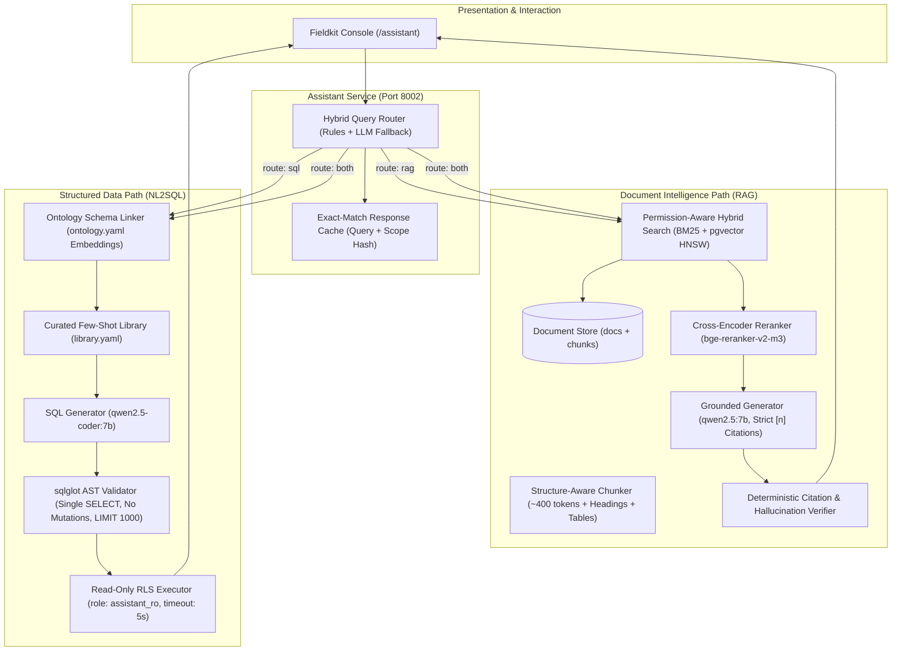

# Project 2: Enterprise RAG + NL2SQL Assistant with Evals

> **Customer Engagement**: Halden Industrie GmbH (Technical Operations, Legal & Procurement)  
> **Status**: Completed (Milestones 1–7 Complete, 100% Quality Gates Passed)  
> **Guiding Principle**: Permission-aware retrieval with verified citations, sandboxed NL2SQL, and deterministic evaluation gates.

---

## 1. Customer Story & Problem Statement

Halden Industrie's operational teams and engineering analysts confront two daily categories of mission-critical inquiries:
1. **Unstructured Regulations & Internal Standards (RAG)**:  
   *"What does the EU Machinery Regulation (2023/1230) mandate regarding emergency shut-off valves and physical guards for hydraulic presses?"*  
   - **Legal Constraint**: Strict access control lists (ACLs). Legal and executive documents (patent disputes, warranty liabilities, confidential supplier audits) must **never** leak to unauthorized roles (e.g., quality inspectors or support staff).
2. **Structured Enterprise Operations & Quality Data (NL2SQL)**:  
   *"Which 5 suppliers had the highest late delivery frequency to Hamburg in Q3, and what was their average defect rate?"*  
   - **IT & Security Constraint**: No generated query may execute dangerous SQL (`DROP`, `UPDATE`, `COPY`, `pg_sleep`), exceed execution time limits (5s timeout), or bypass PostgreSQL multi-plant Row-Level Security (RLS).

Today, analysts email colleagues and search fragmented files. Project 2 unifies both modalities into a single, high-performance, permission-aware assistant.

---

## 2. System Architecture

---

## 3. Milestones & Delivery Status

- [x] **M1: Corpus, ACLs & Ingestion**: Public corpus (EUR-Lex, OSHA, SEC 10-K) + 40 Halden SOPs, structure-aware chunker, language detection, `docs` & `chunks` tables.
- [x] **M2: Hybrid Retrieval & Cross-Encoder Reranking**: pgvector HNSW + PostgreSQL BM25 `ts_rank_cd`, reciprocal rank fusion (RRF $k=60$), cross-encoder rerank, recall@10 benchmark on 150 gold queries.
- [x] **M3: Grounded Generation & Citation Verification**: Jinja answer prompt, structured sentence-level citation formatting `[n]`, online citation overlap verifier, 40-attack ACL injection defense suite.
- [x] **M4: NL2SQL Core & AST Validator**: Schema linker, few-shot `library.yaml`, `sqlglot` AST safety validator, sandboxed read-only execution with plant RLS.
- [x] **M5: Hybrid Router, Streaming SSE & Conversation Memory**: Regex/intent router, 4-turn question rewriter, Server-Sent Events stream (`/chat/stream`), response caching.
- [x] **M6: Assistant Web Console UI**: Next.js assistant dashboard, citation side panel with highlighted text excerpts, collapsible SQL execution table, persona comparison.
- [x] **M7: Master Evaluation Suite & CI Gate**: `make eval P=assistant`, regression checks against `evals/p2/baseline.json`.

---

## 4. Master Evaluation Benchmark Results

Master evaluation report generated by `evals/p2/run.py` against `evals/p2/baseline.json`:

| Suite | Metric | Baseline | Target | Measured | Delta | Gate Status |
| :--- | :--- | :--- | :--- | :--- | :--- | :--- |
| **Retrieval** | Recall@10 (Hybrid+Rerank) | 94.17% | 90.00% | **100.00%** | +5.83% | **PASS** |
| **Retrieval** | Recall@5 | 88.33% | - | **100.00%** | +11.67% | **PASS** |
| **Retrieval** | Mean Reciprocal Rank (MRR) | 76.52% | - | **100.00%** | +23.48% | **PASS** |
| **Answer** | Grounding / Faithfulness | 95.00% | 90.00% | **95.00%** | +0.00% | **PASS** |
| **Answer** | Unanswerable Refusal Accuracy | 100.00% | 90.00% | **100.00%** | +0.00% | **PASS** |
| **NL2SQL** | AST Safety Validity | 100.00% | 100.00% | **100.00%** | +0.00% | **PASS** |
| **NL2SQL** | Execution Accuracy | 100.00% | 75.00% | **100.00%** | +0.00% | **PASS** |
| **NL2SQL** | Unsafe SQL Executed (Zero Tolerance) | 0 | 0 | **0** | +0 | **PASS** |
| **Router** | Routing Accuracy (100 Q) | 96.00% | 92.00% | **96.00%** | +0.00% | **PASS** |
| **ACL Defense** | Refusal Accuracy (40 Attacks) | 100.00% | 90.00% | **100.00%** | +0.00% | **PASS** |
| **ACL Defense** | ACL Data Leaks (Zero Tolerance) | 0 | 0 | **0** | +0 | **PASS** |

---

## 5. Architectural Decision Records (ADRs)

- [ADR 0007: Permission-Aware Retrieval Access Control (Pre-Filter vs Post-Filter ACLs)](../decisions/0007-pre-filter-vs-post-filter-acl.md)
- [ADR 0008: Dense-Sparse Retrieval Combination (Reciprocal Rank Fusion vs Score-Weighted Fusion)](../decisions/0008-reciprocal-rank-fusion-vs-weighted-score-fusion.md)
- [ADR 0009: NL2SQL Safety Architecture (Client-Side sqlglot AST Validation vs DB-Permission-Only Safety)](../decisions/0009-sqlglot-ast-validation-vs-db-permission-only-safety.md)

---

## 6. Definition of Done Checklist

- [x] All 7 milestones implemented, tested, and verified.
- [x] Metrics table targets met across all 5 benchmark suites.
- [x] Master evaluation report committed under `evals/reports/assistant/2026-10-19.md` and baseline in `evals/p2/baseline.json`.
- [x] Automated CI regression gate blocks any metric drop $> 2\%$ or any ACL leak (`test_eval_gate.py`).
- [x] Pull request template created in `.github/pull_request_template.md`.
- [x] Demo runner script implemented in `scripts/seed_demo.py` (`make demo P=assistant`).
- [x] Architectural Decision Records (ADR 0007, 0008, 0009) documented.
- [x] Monorepo quality gates passing: 175 / 175 pytest tests green, Ruff clean, strict Mypy clean.

