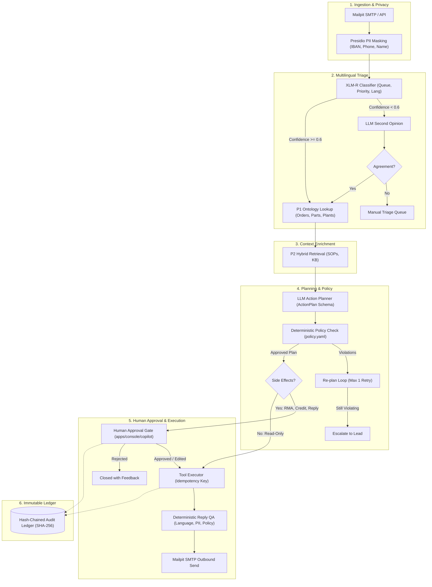

# Project 3: Multi-Agent Ops Copilot with Human-in-the-Loop (HITL)

> **Customer Engagement**: Halden Industrie GmbH (Technical Support & Operations)  
> **Status**: In Progress — Milestone 1 (Data Preparation & Classifier Baselines)  
> **Guiding Principle**: State machine over free-roaming agents; deterministic policy checks before execution; mandatory human approval on any side effect; tamper-evident audit chaining.

---

## 1. Customer Story & Problem Statement

**Lukas (Support Ops Lead)** at Halden Industrie manages 40,000 support and warranty tickets annually across Germany and export markets:
- **45% of tickets are in German**, 55% in English.
- Average first-response time is **19 hours** due to manual triage and fragmented investigation across ERP databases and engineering specs.
- Recurring defects (e.g. leaking seal rings on the `HX-400` hydraulic valve series) are reported hundreds of times before engineering or procurement notices the pattern.
- **Strict Management Requirement**: Complete automation of routine triage, but **zero refunds, RMAs, or customer replies may ever execute autonomously without human sign-off**.

**Project 3 builds an agentic support desk**:
1. Triages English and German tickets with a fast local classifier.
2. Masks PII at intake before any LLM sees customer details.
3. Enriches tickets from the P1 ontology and P2 technical knowledge base.
4. Generates structured action plans from a strictly typed tool registry.
5. Enforces deterministic business policy rules (credits $\le$ €500, RMA within 90 days, legal-hold customer block).
6. Pauses via human approval interrupts for side-effect actions.
7. Logs every state transition in a hash-chained, tamper-evident audit ledger.
8. Produces weekly emerging-issue cluster reports via BERTopic into Project 7.

---

## 2. Architecture & State Machine

---

## 3. Milestones & Delivery Schedule

- [x] **M1: Data and Classifier Baselines**:
  - Load customer support dataset, stratified split 70/15/15 by `(language, queue)` with seed 42.
  - Freeze `evals/p3/clf_test.parquet`.
  - Implement 4 baselines: (a) TF-IDF char 3-5 n-grams + LogisticRegression, (b) Dense multilingual embeddings + LogisticRegression, (c) LLM zero-shot, (d) LLM 5-shot.
  - Compare Macro-F1 (overall, EN, DE), accuracy, latency P50/P95, and compute cost per 10k tickets.
- [ ] **M2: Fine-Tune XLM-R on Kaggle & Export ONNX**:
  - Train multi-task `xlm-roberta-base` with shared encoder and dual heads (`queue`, `priority`).
  - Export to ONNX + int8 dynamic quantization for CPU inference ($< 30\text{ ms/ticket}$).
- [ ] **M3: Tools, Mock ERP & Policy Engine**:
  - Pydantic tool registry with `side_effect: bool` flags (`lookup_order`, `create_rma`, `issue_credit`, etc.).
  - Mock ERP service with idempotency keys and simulated transient 503 errors.
  - Deterministic `policy.yaml` rules engine (credit $\le$ €500, delivery date $< 90$ days, legal-hold customer block).
- [ ] **M4: LangGraph State Machine, Approvals & Hash-Chained Audit**:
  - State machine with Postgres checkpointer.
  - Human approval interrupt on any side-effect action.
  - Hash-chained audit event logging with SHA-256 tamper detection.
- [ ] **M5: Reply QA, Outbound Send & Emerging Insights**:
  - Deterministic outbound reply QA (PII leak prevention, language matching).
  - Outbound email dispatch via Mailpit SMTP.
  - Nightly BERTopic clustering and growth tracking with alerts to Project 7.
- [ ] **M6: Approval Web Console UI**:
  - Next.js console at `/copilot`: triage inbox, PII toggle, plan review, one-click approve/edit/reject, timeline.
- [ ] **M7: 60-Scenario Evaluation Suite**:
  - Automated scenario runner testing task success, policy adherence, and zero unauthorized side effects.

---

## 4. Target Metrics

| Metric | Target Threshold | Description |
| :--- | :--- | :--- |
| **Queue Macro-F1 (XLM-R EN / DE)** | $\ge 0.85$ / $\ge 0.82$ | Must exceed LLM zero-shot performance |
| **Classifier CPU Latency** | $< 30\text{ ms}$ per ticket | Local int8 quantized ONNX inference on CPU |
| **Scenario Task Success** | $\ge 85.0\%$ | Across 60 end-to-end agentic scenarios |
| **Side-Effects Without Approval** | **Strictly 0** | Zero autonomous side-effect mutations |
| **Policy-Violating Actions** | **Strictly 0** | Zero policy violations reaching execution |
| **PII Leaked into LLM Prompts** | **Strictly 0** | Presidio masking enforced prior to LLM calls |
| **Audit Chain Tamper Detection** | **100.0%** | Verification detect any altered hash or payload |
