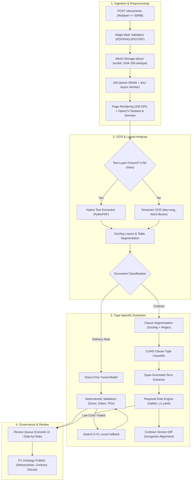

# Project 4: Contract and Document Intelligence Engine (DocAI)

> **Customer Engagement**: Halden Industrie GmbH (Procurement & Warehouse Operations)  
> **Status**: In Progress — Milestone 1 (Ingestion, Preprocessing, and OCR Pipeline)  
> **Guiding Principle**: Span grounding over blind generation; deterministic validation before ERP ingestion; visual human verification with bounding-box highlighting.

---

## 1. Customer Story & Problem Statement

**Sofia Schmidt (Procurement Legal Counsel)** at Halden Industrie (Wrocław plant `PL-WRO`) oversees 1,800 active supplier contracts and master agreements:
- Lacks visibility into supplier liability caps, indemnity exposures, and automatic renewal clauses with notice periods $< 90$ days.
- Cross-referencing supplier contracts with active POs is done manually across filing cabinets and network shares.

**Shop-Floor & Warehouse Logistics**:
- The intake depots across Hamburg, Stuttgart, and Wrocław receive ~300 paper/scanned delivery notes daily.
- Operators manually transcribe line items, quantities, and PO references into SAP/ERP with a **2.4% keystroke error rate**.
- Unmatched delivery notes create invoice disputes, delayed inventory updates, and procurement friction.

**Core Requirements**:
1. **Span Grounding**: Every extracted entity or clause must map to verifiable character spans and 2D bounding boxes on the original page image. Hallucinated or ungrounded values are discarded.
2. **Deterministic Mathematical & Relational Validation**: Delivery note line quantities must sum to totals, delivery dates must be within valid PO windows, and PO numbers must match the Halden P1 ontology.
3. **Audit & Review Workflow**: Side-by-side visual PDF viewer highlighting extracted entities with color-coded confidence flags.

---

## 2. Architecture & Processing Pipeline

---

## 3. Milestones & Delivery Schedule

- [x] **M1: Ingestion, Preprocessing & OCR Pipeline**:
  - Magic-byte file validation (PDF, PNG, JPEG, TIFF; reject disguise extensions).
  - SHA-256 content deduplication and MinIO upload.
  - Asynchronous job queue with idempotent, resumable `document_step` tracking.
  - Page rendering (200 DPI) via PyMuPDF / pdf2image.
  - OpenCV deskewing (`minAreaRect` on text mask, skip if angle $< 0.3^\circ$) and selective denoising.
  - Text layer detection with Tesseract OCR (`deu+eng`) fallback with word bounding boxes.
  - Docling layout block segmentation (bounding boxes, block types, page indices).
- [ ] **M2: Synthetic Delivery Notes & Donut Fine-Tuning**:
  - Generate 8,000 synthetic German/English delivery notes across 6 templates (30% scanned degradation).
  - Fine-tune Donut base model on Kaggle GPU and export for local CPU inference.
  - Benchmark on unseen templates.
- [ ] **M3: Delivery Note Extractor, Validators & VLM Fallback**:
  - Deterministic validators: PO existence, supplier matching, quantity sum check, date bounds.
  - Confidence fusion with local Qwen2.5-VL fallback.
- [ ] **M4: Contract Clause Segmentation & CUAD Classifier**:
  - Hierarchical clause segmenter (numbering, headings, Docling layout).
  - Multi-label clause classifier trained on CUAD dataset.
- [ ] **M5: Playbook Rules Engine & Version Diff**:
  - Deterministic evaluation of `playbooks/halden_v1.yaml` (liability cap $\le 2\times$ value, German governing law, renewal notice $\ge 90$ days).
  - Clause-level version diff with Hungarian alignment and material redline detection.
- [ ] **M6: Document Intelligence Web Console UI**:
  - Next.js 14 console at `/docai`: side-by-side viewer, visual bounding box highlights, human correction queue.
- [ ] **M7: 50+ Document Evaluation Benchmark Suite**:
  - Comprehensive automated benchmark testing extraction F1, span grounding accuracy, and playbook risk detection recall.

---

## 4. Target Metrics

| Metric | Target Threshold | Description |
| :--- | :--- | :--- |
| **Magic-Byte Rejection Accuracy** | **100.0%** | Zero disguised files bypass validation |
| **Deskew Angle Residual** | $< 0.5^\circ$ | High-precision rotation correction |
| **Worker Step Idempotency** | **100.0%** | Resumable after worker termination with 0 corruptions |
| **Delivery Note Field F1** | $\ge 0.90$ | Key fields: PO, supplier, date, line items, total |
| **Clause Span Grounding Accuracy** | $\ge 95.0\%$ | Extracted clauses must be exact substrings |
| **Playbook Risk Detection Recall** | $\ge 90.0\%$ | Flagging un-capped liability and short renewal notices |
| **End-to-End Page Latency (CPU)** | $< 2.5\text{ s}$ per page | Local CPU inference without cloud APIs |
