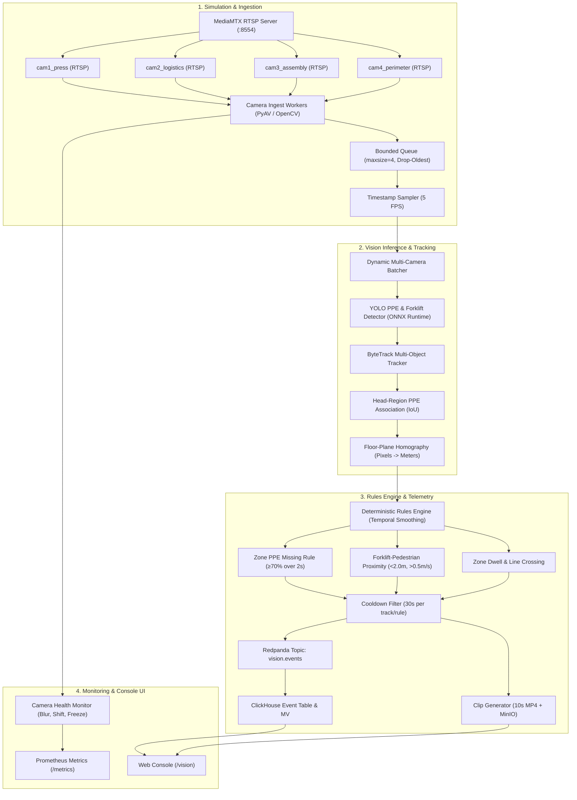

# Project 5: Multi-Camera Edge Video Analytics Platform (Vision Edge)

> **Customer Engagement**: Halden Industrie GmbH (Plant Safety & Logistics Operations, Hamburg `DE-HAM`)  
> **Status**: In Progress — Milestone 1 Delivered  
> **Guiding Principle**: High alert quality over raw model precision; deterministic rule smoothing over single-frame triggers; real-time edge processing on local CPU/GPU with zero cloud APIs.

---

## 1. Customer Story & Problem Statement

**Jana Weber (Operations & EHS Safety Lead)** at Halden Industrie (Hamburg plant `DE-HAM`) oversees 60 factory and warehouse security cameras:
- Existing cameras record continuously to network drives, but nobody watches them in real time.
- Previous commercial computer vision pilots suffered from **>400 false alarms per day** (e.g. workers taking helmets off for 1 second, flickering shadows triggering false forklift detections), leading operators to shut the system off entirely.
- Safety regulations mandate strict PPE compliance in heavy machinery press zones (mandatory hardhats & safety vests) and pedestrian–forklift separation (minimum 2.0 m distance).

**Core Requirements**:
1. **Low False Alarm Rate**: $\le 0.5$ false alarms per camera-hour via temporal rule smoothing (requiring $\ge 70\%$ violation over a 2.0 s rolling window).
2. **Metric Distance Enforcement**: Floor-plane homography calibration (4-point transformation from image coordinates to meters) ensuring proximity checks measure physical meters, not distorted perspective pixels.
3. **Resilient Edge Ingestion**: Process 4 simulated RTSP camera feeds at 5 FPS sustained on local hardware with drop-oldest queue backpressure, exponential reconnect backoff, and camera health diagnostics (freeze, blur, view shift).
4. **Audit Trail & Privacy**: Automatic 10 s MP4 event clip generation (5s pre, 5s post) with face blurring for worker privacy, saved to MinIO with event metadata in ClickHouse.

---

## 2. Architecture & Processing Pipeline

---

## 3. Milestones & Delivery Schedule

- [x] **M1: Camera Simulation & Robust Ingest Worker**:
  - Docker Compose with MediaMTX RTSP server and 4 looping FFmpeg publishers.
  - Ingest worker per camera with TCP transport, 5s timeout, timestamp-based 5 FPS sampling.
  - Bounded `asyncio.Queue(maxsize=4)` with drop-oldest backpressure (never unbounded memory).
  - Exponential reconnect backoff with jitter (up to 30s).
  - Per-camera metrics (`decoded_fps`, `processed_fps`, `dropped_frames`, `reconnects`).
  - Chaos injection flag to simulate stream drops and verify automatic recovery.
- [ ] **M2: PPE & Forklift Detector (YOLO fine-tuning & ONNX export)**:
  - Dataset merge: Person, Helmet, No-Helmet, Vest, Forklift.
  - Train YOLO models on Kaggle GPU and export ONNX with dynamic batching.
  - Detector module with letterbox preprocessing, NMS, and CPU/CUDA benchmark.
- [ ] **M3: Tracking, Helmet Association & Homography**:
  - ByteTrack tracking per camera.
  - Helmet assignment to top 25% head region of person bounding box.
  - 4-point homography calibration from image pixels to metric floor coordinates.
- [ ] **M4: Deterministic Rules Engine, Redpanda Events & Video Clips**:
  - Temporal smoothing rules: `zone_ppe_missing`, `forklift_pedestrian_proximity`, `dwell`.
  - 30s alert cooldown to prevent alert fatigue.
  - Redpanda `vision.events` topic and ClickHouse storage.
  - 10s MP4 ring-buffer event clips with MinIO upload.
- [ ] **M5: Cross-Camera Re-ID & Camera Health Diagnostics**:
  - OSNet person crop embeddings and transit-time topology matching.
  - Health checks: frozen frames, black frames, blur (Laplacian variance), view shift (ORB keypoints).
  - Privacy face blurring on stored clips.
- [ ] **M6: Search API & Web Console UI (`/vision`)**:
  - Event search API with structured and natural language query filters.
  - Next.js 14 console with 4-camera live wall, event clips, mini-map, and health status.
- [ ] **M7: Evaluation Benchmark & Load Testing**:
  - 30 annotated clips evaluation: rule precision/recall and false alarms per camera-hour.
  - Ablation study: temporal smoothing vs single-frame triggers.
  - Sustained 4-camera 5 FPS throughput benchmark.

---

## 4. Target Metrics

| Metric | Target Threshold | Description |
| :--- | :--- | :--- |
| **Ingest Sampling Rate** | $5.0 \pm 0.2\text{ FPS}$ | Exact timestamp-based sampling |
| **Worker Queue Memory** | $\le 4\text{ frames}$ | Strict drop-oldest bounded queue under backpressure |
| **Stream Reconnect Time** | $< 30\text{ s}$ | Exponential backoff recovery upon RTSP source drop |
| **Detector mAP50** | $\ge 0.80$ | Person, helmet, no-helmet, forklift |
| **Rule Precision** | $\ge 0.90$ | With temporal smoothing (2s window) |
| **False Alarms per Camera-Hour** | $\le 0.5$ | Eliminating alert fatigue on shop floor |
| **Frame-to-Event Latency (P95)** | $< 1.0\text{ s}$ | Near real-time alert generation |
| **Camera Health Anomaly Detection** | $100.0\%$ | Within 30s of injected freeze, black, or blur |
