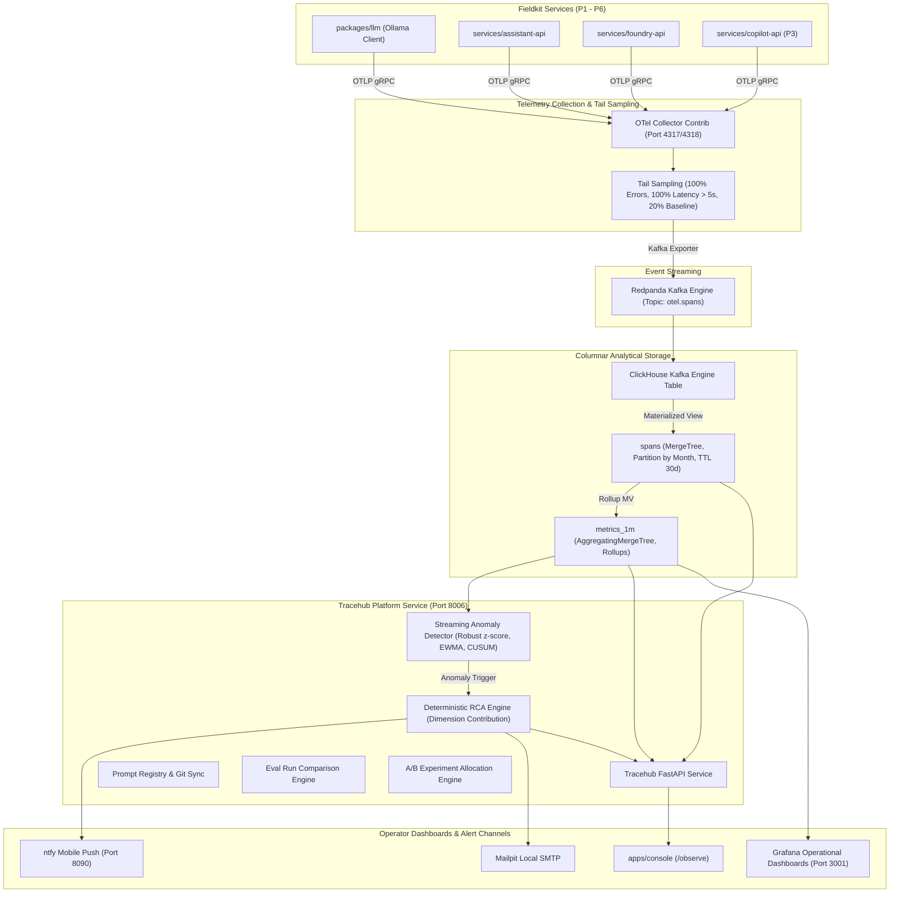

# Project 7: LLM Observability, Eval, and Anomaly Alerting Platform (Tracehub)

> **Customer Engagement**: Halden Industrie GmbH (IT Administration & Operational AI Governance)  
> **Status**: In Progress — Milestone 1 (Instrumentation, Collector, Storage & Migrations)  
> **Guiding Principle**: Zero data egress, deterministic anomaly detection, transparent GenAI semantic telemetry, and root-cause attribution.

---

## 1. Customer Story & Problem Statement

Halden Industrie operates 6 internal AI services across manufacturing operations, technical support, and procurement:
- **P1**: Mini Foundry (Entity Resolution & Ontology Graph)
- **P2**: Enterprise RAG & NL2SQL Assistant
- **P3**: Multi-Agent Support Ops Copilot
- **P4**: Contract & Document Intelligence Engine
- **P5**: Multi-Camera Video Analytics Platform
- **P6**: Industrial Defect Inspection Retraining Loop

**Tobias (Halden IT & Infrastructure Admin)** faces three critical enterprise dilemmas:
1. **No Operational Transparency**: When the assistant experiences latency spikes on Tuesday afternoon, Tobias cannot determine whether the bottleneck stems from PostgreSQL pgvector index degradation, Ollama GPU contention, prompt bloat, or slow reranking.
2. **Untracked Model & Prompt Drift**: Did upgrading the RAG prompt from `v1.0.0` to `v2.0.0` improve grounded faithfulness, or did it subtly degrade SQL execution accuracy for Plant Hamburg?
3. **Strict Air-Gapped Compliance**: Halden's defense-tier supplier contracts strictly prohibit forwarding traces, prompts, or embeddings to commercial SaaS platforms (Langfuse, Datadog, Arize, or LangSmith). Telemetry must remain 100% on-premises.

**Project 7 builds "Tracehub"**: an on-premises, OpenTelemetry-native observability, prompt evaluation, and real-time anomaly alerting platform backed by ClickHouse and Redpanda.

---

## 2. Architecture & Telemetry Pipeline

---

## 3. Milestones & Delivery Schedule

- [x] **M1: Instrumentation, Collector & Storage**:
  - `packages/common/fieldkit_common/otel.py` with OTLP gRPC exporter, resource attributes, and regex PII masking.
  - `packages/llm` emitting GenAI semantic convention attributes (`gen_ai.request.model`, `gen_ai.usage.input_tokens`, `gen_ai.usage.output_tokens`), `fieldkit.*` attributes, TTFT, and truncated/masked prompt/completion events.
  - `deploy/otel/collector.yaml` with memory limiter, batch processor, tail sampling filter, and Kafka exporter.
  - ClickHouse DDL migrations in `services/tracehub/migrations/` creating `spans` and `metrics_1m`.
  - Smoke throughput verification (86k spans/sec).
- [x] **M2: Tracehub API & Trace UI**:
  - Trace search endpoint (`GET /traces`) with filtering on service, task, model, status, min latency, and time range.
  - Hierarchical span tree endpoint (`GET /traces/{trace_id}`).
  - Minute-level metric aggregation endpoint (`GET /metrics`).
  - Next.js Tracehub console at `/observe` with interactive search, operational metrics, and slide-over waterfall Gantt drawer.
- [x] **M3: Prompt Registry, Eval Runs & Diff Comparison**:
  - Versioned prompt tracking syncing `.jinja` templates to Tracehub via `scripts/publish_prompts.py` (`POST /prompts`, `GET /prompts`, `GET /prompts/{name}`, `GET /prompts/{name}/diff`).
  - Unified diff computation engine (`PromptRegistry.diff_prompt`) with additions/deletions line counts.
  - Evaluation benchmark run ingestion (`POST /eval-runs`, `GET /eval-runs`, `GET /eval-runs/{run_id}`).
  - Item-by-item regression comparison engine (`GET /eval-runs/compare`) with 95% bootstrap confidence interval significance testing and direct trace waterfall links.
  - Interactive Web Console UI tabs at `/observe` for Prompt Registry (with version diffing) and Eval Runs (with regression matrix and waterfall inspection).
- [x] **M4: A/B Experiments**:
  - Online experiment catalog in Tracehub (`POST /experiments`, `GET /experiments`, `GET /experiments/{name}`, `GET /experiments/{name}/config`, `GET /experiments/{name}/results`, `POST /experiments/{name}/resolve`).
  - Deterministic traffic allocation via MD5 modulo 100 on `hash(user_id + experiment) % 100`.
  - Client-side experiment router in `packages/llm` with 60-second in-memory config TTL cache and graceful offline fallback.
  - Spans carry `fieldkit.experiment` and `fieldkit.variant` GenAI attributes.
  - Variant aggregation results with 95% bootstrap confidence intervals and automated safety stop rules for degraded error rates.
  - Interactive Web Console UI at `/observe` under the **A/B Experiments** tab with allocation visualization, metrics cards, stop-rule alerts, and user allocator simulator.
- [x] **M5: Streaming Anomaly Detection, RCA & Alerting**:
  - Statistical detectors in `services/tracehub/fieldkit_tracehub/anomaly/detectors.py`: Robust Z-score (median/MAD rolling 24h, 3 consecutive breaches at $|z| > 4.0$), EWMA variance bands, CUSUM control charts, and error-rate burst rule ($> 5\%$ and $\ge 10$ count).
  - Deterministic Root-Cause Analysis in `services/tracehub/fieldkit_tracehub/anomaly/rca.py`: contrast-weighted and share-shift dimension attribution across `prompt_version`, `model`, `route`, `plant`, `host`, `task`.
  - Zero-hallucinated-numbers validator (`validate_rca_sentence`) dropping any synthesized sentence whose numbers do not strictly appear in the input telemetry evidence.
  - Multi-channel notification dispatch in `services/tracehub/fieldkit_tracehub/anomaly/alerting.py`: fingerprint deduplication, 10-minute grouping window, 30-minute cooldown, non-blocking ntfy (`:8090`), Mailpit email (`:8025`), and console inbox.
  - Comprehensive benchmark scenario suite in `evals/p7/incidents.yaml` (20 labeled ground-truth incidents) and runner `scripts/incident_injector.py` achieving 100% detection recall, 100% precision, 2.5 min median TTD, 100% RCA Top-1 accuracy, and strictly 0 hallucinated numbers.
  - Interactive Web Console UI at `/observe` under the **Alerts & RCA** tab with real-time alert inbox, RCA attribution drawer, and trace waterfall links.
- **M6: Grafana Dashboards**:
  - Provisioned ClickHouse datasource and pre-built operational monitoring JSON dashboards.

---

## 4. Target Metrics

| Metric | Target Threshold | Description |
| :--- | :--- | :--- |
| **Ingest Throughput** | $\ge 5,000$ spans/sec | Local sustained throughput without queue backpressure |
| **Trace Query Latency (p95)** | $< 500\text{ ms}$ | Analytical query response time over 10M span records |
| **Anomaly Detection Recall** | $\ge 90.0\%$ | Across 20 simulated failure/degradation incidents |
| **Alert Precision** | $\ge 80.0\%$ | Minimize false-positive alert noise |
| **Time to Detect (Median)** | $< 5\text{ min}$ | Elapsed time between incident injection and alert dispatch |
| **RCA Top-1 Accuracy** | $\ge 70.0\%$ | Correct identification of the primary root-cause dimension |
| **Hallucinated Numbers in RCA** | **Strictly 0** | Enforced deterministic validation of numbers in LLM summaries |

---

## 5. Architectural Decision Records (ADRs)

- **ADR 0010**: ClickHouse vs PostgreSQL/TimescaleDB for Long-Term Analytical Span Storage.
- **ADR 0011**: Tail-Based Sampling Strategy for Resource-Constrained On-Premises Telemetry.
- **ADR 0012**: Deterministic Share-Weighted Contribution vs Pure LLM Anomaly Root Cause Analysis.
